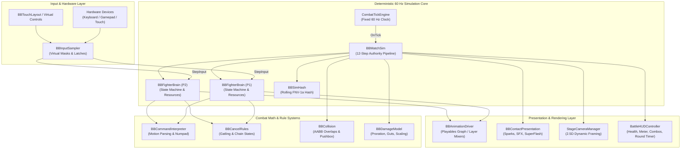
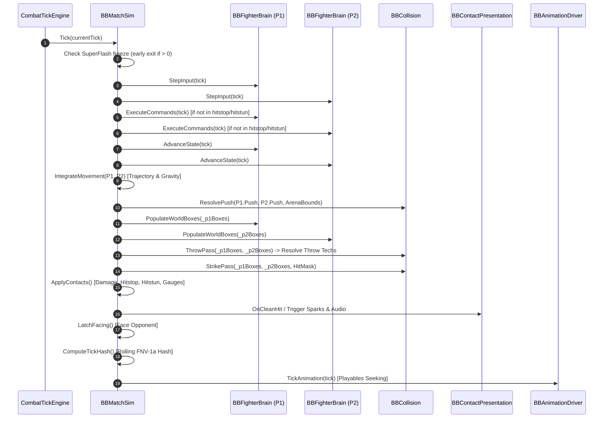
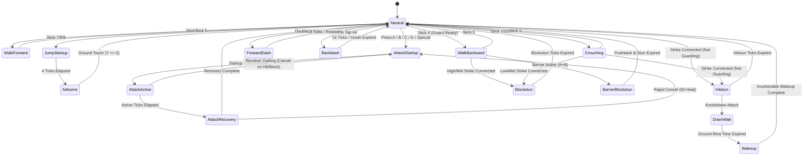
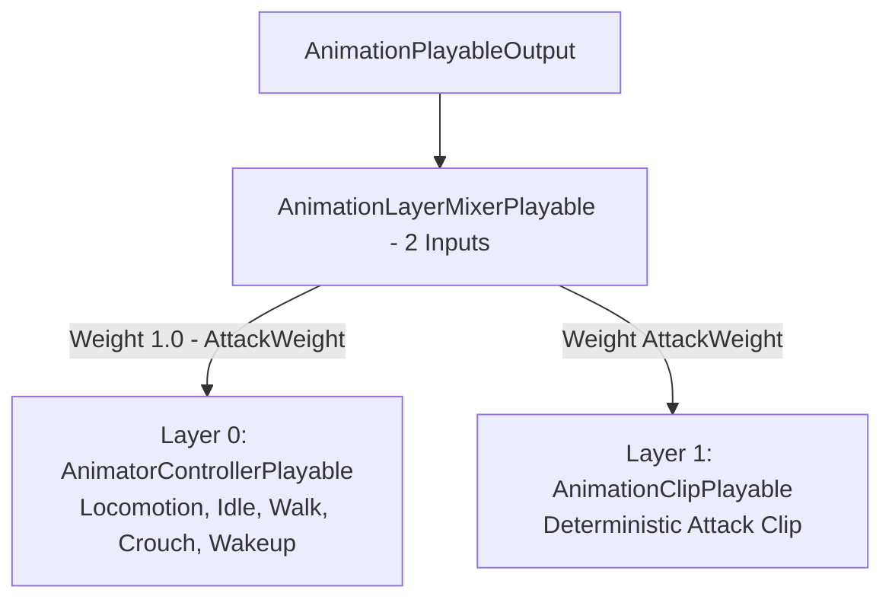
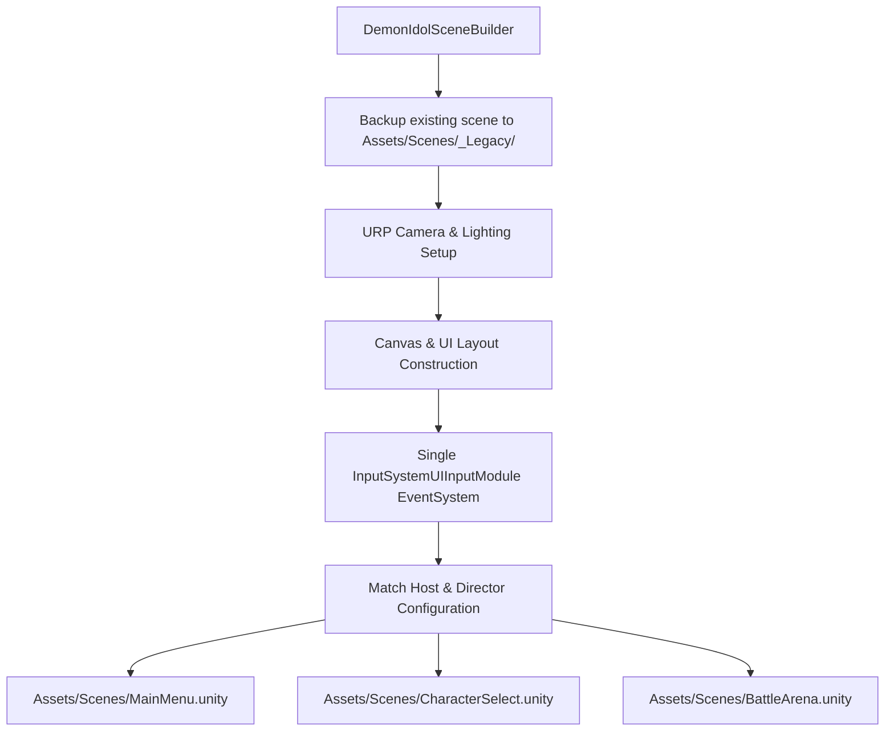
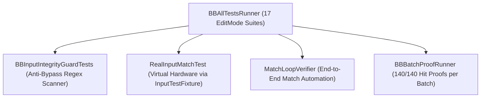
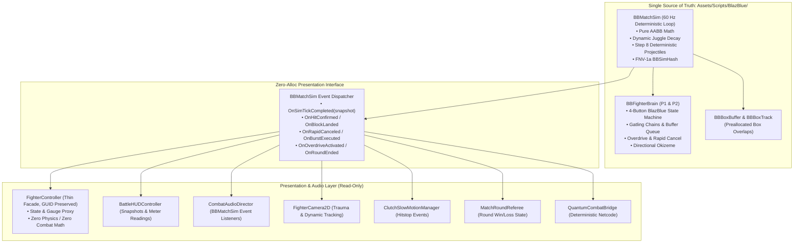

# My Demon Idol (MDI): Ultra-Detailed Code-Level Architecture & Technical Analysis

> **Document Purpose**: This document provides an exhaustive, code-level architectural analysis of the entire **My Demon Idol (MDI)** fighting game codebase. It dissects every major engine layer, data structure, deterministic simulation step, state machine, input/command interpreter, collision geometry, animation driver, AI decision pipeline, scene construction system, and verification harness.

---

## 1. Executive Summary & System Topology

### 1.1 Architectural Vision & Foundations
**My Demon Idol (MDI)** is a 2.5D fighting game built in Unity (Unity 6 / `6000.6.8f1-arm64`) utilizing a **hybrid deterministic simulation authority** heavily inspired by *BlazBlue: Central Fiction* (4-button layout: **A, B, C, D** with Drive mechanics, Revolver Action gatlings, Rapid Cancels, and Distortion Drives).

The engine strictly enforces four foundational architectural tenets:
1. **Decoupled Simulation Clock (60 Hz Fixed Tick)**: Combat logic (hitboxes, frame data, active/startup/recovery states, hitstop, hitstun, blockstun) runs at a strictly deterministic 60 Hz via `CombatTickEngine`, decoupled from variable presentation frame rates (60 Hz, 90 Hz, 120 Hz on mobile/desktop).
2. **Physics-Free Planar Math ($Z=0$)**: Standard Unity physics (`Rigidbody`, `PhysX`, `CharacterController` movement) are completely discarded during active combat ticks. All spatial resolutions, pushbox separations, and hitbox overlaps use pure 2D Axis-Aligned Bounding Box (AABB) arithmetic.
3. **Zero Mid-Match Memory Allocations**: The core combat loop generates zero garbage per tick. All collision queries, box buffers, contact results, and command edge histories use preallocated static structures, bitmasks, and structs.
4. **Deterministic Animation via Unity Playables API**: Animations are driven deterministically via `PlayableGraph` seeking (`AnimationClipPlayable.SetTime`), bypassing non-deterministic state machine transitions during attack execution.

### 1.2 High-Level Architecture Topology



---

## 2. Core Deterministic Simulation Pipeline

### 2.1 The 60 Hz Clock (`CombatTickEngine.cs`)
The heart of the simulation is `CombatTickEngine.cs`.
- **Tick Interval**: Exactly $16.666\text{ms}$ ($\frac{1}{60}\text{s}$).
- **Time Accumulator**: `_timeAccumulator += Time.unscaledDeltaTime;`
- **Spiral of Death Clamp**: Clamped at `0.2f` ($12$ ticks max per frame) to prevent runaway catch-up loops during major system hitches.
- **Superfreeze Ticks**: When `SuperfreezeTicksRemaining > 0`, match logic can be frozen while specialized super presentation updates independently.
- **Render Interpolation Alpha**: `InterpolationAlpha = Mathf.Clamp01(_timeAccumulator / TICK_DELTA_TIME)` allows presentation objects to smoothly interpolate between tick $N$ and tick $N+1$.

```csharp
while (_timeAccumulator >= TICK_DELTA_TIME)
{
    _timeAccumulator -= TICK_DELTA_TIME;
    CurrentTick++;
    if (SuperfreezeTicksRemaining > 0)
    {
        OnSuperfreezeTick?.Invoke(SuperfreezeTicksRemaining);
        OnTick?.Invoke(CurrentTick);
        SuperfreezeTicksRemaining--;
    }
    else
    {
        OnTick?.Invoke(CurrentTick);
    }
}
```

### 2.2 The 12-Step Authority Pipeline (`BBMatchSim.cs`)
Every 60 Hz tick, `BBMatchSim.cs` executes a strict, ordered 12-stage cycle:



#### Detailed Stage Breakdown:
1. **Super Flash Check**: If `BBSuperFlash.FreezeTicks > 0`, decrements timer and aborts normal sim tick, freezing action for cinematic effect.
2. **Step 1: Input Sampling**: Calls `brain.StepInput(tick)` on P1 and P2, converting latched virtual inputs into a compact `BBInputFrame` and recording it into the 64-tick history ring buffer.
3. **Step 1.5: Command Execution**: Evaluates buffered inputs and executes attacks or dashes via `brain.ExecuteCommands(tick)`. Skipped if the fighter is in hitstop or hitstun.
4. **Step 2: Advance State**: Advances state timers, decrements hitstop/blockstun/hitstun, checks recovery, handles wakeup/down states, and updates locomotion states.
5. **Step 3: Movement Integration**: Applies motion track displacements (from attack data) or kinematic physics (ground walk speeds, airborne gravity $g = 20.0\text{m/s}^2$, jump velocity).
6. **Step 4: Pushbox Resolution**: Evaluates pushbox overlap between P1 and P2 via `BBCollision.ResolvePush`. Clamps both fighters within the active arena bounds ($X \in [-8.5\text{m}, +8.5\text{m}]$) and prevents character pass-through.
7. **Step 5: World Box Generation**: Clears preallocated `BBBoxBuffer` instances and populates world-space AABB coordinates for Hurt, Hit, Push, and Throw boxes based on current frame and facing direction.
8. **Step 6: Throw Resolution**: Runs `BBCollision.ThrowPass`. If both fighters connect throws simultaneously, `ResolveThrowTech()` triggers a throw break.
9. **Step 7: Strike Collision**: Runs `BBCollision.StrikePass` checking attacker Hit boxes against defender Hurt boxes. Filters by `BBHitMask` (preventing multi-hit on single active frames) and defender invulnerabilities (`BBInvuln`).
10. **Step 8: Contact Resolution**: In `ApplyContacts()`, calculates scaled damage via `BBDamageModel`, applies hitstop to attacker and defender, applies hitstun/blockstun, awards Heat/Tension meter, and invokes visual/audio presentation.
11. **Step 9: Facing Latch**: Evaluates relative X positions and latches facing directions (P1 facing right, P2 facing left) when in neutral or recoverable states.
12. **Step 10: State Hash**: Generates a 32-bit FNV-1a hash of the entire match state via `BBSimHash.ComputeTickHash` for rollback verification and desync detection.
13. **Step 11: Presentation Driver**: Ticks `BBAnimationDriver.TickAnimation` to update the Playables mixer and seek the attack animation clip to the exact frame time.

---

## 3. Fighter State Machine & Cancel Rules

### 3.1 Fighter State Machine (`BBEnums.cs` & `BBFighterBrain.cs`)
Fighters operate under a 23-state discrete automaton defined by `BBState`:



### 3.2 The Revolver Action Gatling System (`BBCancelRules.cs`)
The cancel architecture is governed by `BBCancelRules.cs` and tracked via `BBChainState`.

```csharp
[Serializable]
public struct BBChainState
{
    public ulong usedMask;           // Bitmask of move indices used in current chain (max 64)
    public byte aRepeatCount;        // Count of A normals used consecutively in this chain (max 3)
    public bool hasJumpCanceled;     // Jump cancel used in this ground chain
    public bool hasSpecialCanceled;  // Special cancel used in this chain
    public bool madeContact;         // Attack made contact (hit or block)
    public int contactTick;          // Tick when attack connected
}
```

#### Gatling Progression Matrix:
1. **Normal Chain Progression**:
   $$\text{5A / 2A} \longrightarrow \text{5B / 2B} \longrightarrow \text{5C / 2C} \longrightarrow \text{5D / 2D}$$
2. **Reverse Gatling**: Forbidden in standard mode. An attack cannot cancel into an equal or lower tier normal unless explicitly authored in `GatlingInto` or within A-repeat allowances.
3. **A-Repeat Rules**: A-normals can chain into themselves up to a strict limit of 3 consecutive presses (`DEFAULT_MAX_A_REPEATS = 3`).
4. **Special Cancels**: Any normal can cancel on hit or block into a Special Move ($236\text{A}, 214\text{B}$) or Command Normal.
5. **Distortion Drive Cancels**: Specials and Normals can cancel into Distortion Drives ($236236\text{C}$) provided the fighter possesses $\ge 50$ Heat.
6. **Rapid Cancel**:
   - Activated via $A+B+C$ on any active or recovery frame on hit/block.
   - Cost: Exactly 50 Heat.
   - Effect: Triggers a 4-tick superfreeze, immediately aborts the active attack, clears recovery frames, resets chain state, and returns the fighter to `Neutral`, enabling extended combo loops.
7. **Jump Cancel (JC)**:
   - Normals flagged with `JumpCancelOnHit` or `JumpCancelOnBlock` can cancel into a jump on contact, allowing aerial combo extensions.
   - Limited to 1 jump cancel per ground chain (`hasJumpCanceled`).

---

## 4. Input Pipeline, History Buffering & Command Parsing

### 4.1 Multi-Device Input Sampling (`BBInputSampler.cs`)
Input is gathered from multiple physical and virtual layers:
- **Hardware Keyboard**: Standard fight keys (WASD for movement, J = A, K = B, L = C, U/I = D, Space = Rapid Cancel).
- **Gamepad**: Left Stick / D-Pad, Face buttons (South = A, West = B, East = C, North = D).
- **Virtual Touch Controls**: On-screen dynamic stick and button clusters (`BBTouchLayout`).
- **Virtual Injection Masks**: `virtualHeldMask`, `virtualPressedMask`, and `virtualStickInput` allow automated tests and verifiers to press real inputs without bypassing gameplay state.

### 4.2 Numpad Directional Encoding & Coordinate Normalization
Movement directions are represented using standard fighting game numpad notation:

$$\begin{matrix} 7 & 8 & 9 \\ 4 & 5 & 6 \\ 1 & 2 & 3 \end{matrix}$$

Because fighters face each other dynamically, `BBInputFrame.WorldToFacingNumpad` transforms raw world directions into character-facing relative directions:
- When facing Right ($+1$): World 6 = Forward (6), World 4 = Back (4).
- When facing Left ($-1$): World 6 = Back (4), World 4 = Forward (6).

```csharp
public static sbyte WorldToFacingNumpad(sbyte worldNumpad, int facingDirection)
{
    if (facingDirection >= 0) return worldNumpad;
    switch (worldNumpad)
    {
        case 6: return 4;
        case 4: return 6;
        case 9: return 7;
        case 7: return 9;
        case 3: return 1;
        case 1: return 3;
        default: return worldNumpad;
    }
}
```

### 4.3 Input History Ring Buffer & Command Interpreter
`BBInputHistory.cs` maintains a 64-tick circular buffer of `BBInputFrame` structs. Whenever a directional change occurs, it generates a `BBMotionEdge`.

`BBCommandInterpreter.cs` parses these edges against canonical motion templates with a 12-tick leniency window:
- **Quarter Circle Forward (236)**: Requires sequences matching $2 \to 3 \to 6$ or $2 \to 6$.
- **Quarter Circle Back (214)**: Requires sequences matching $2 \to 1 \to 4$ or $2 \to 4$.
- **Dragon Punch (623)**: Requires $6 \to 2 \to 3$ or $6 \to 2 \to 6$.
- **Double Quarter Circle (236236)**: Requires two distinct $236$ patterns within 24 ticks.
- **Priority Resolution**: Evaluated in strict order of complexity:
  $$\text{Astral Heat} > \text{Distortion Drive (Super)} > \text{Special Motion} > \text{Command Normal} > \text{Neutral Normal}$$

---

## 5. Collision Geometry, AABB Mathematics & Damage Engine

### 5.1 Planar Box Architecture (`BBBox.cs` & `BBCollision.cs`)
Collision takes place strictly on the $Z=0$ 2D plane. All boxes are defined by `BBWorldBox`:

```csharp
public struct BBWorldBox
{
    public BBBoxKind kind;       // Push, Hurt, Hit, Throw, ThrowHurt
    public BBAttribute attribute;// Head, Body, Foot, Projectile
    public int hitIndex;         // Unique index for multi-hit tracking
    public float minX;
    public float maxX;
    public float minY;
    public float maxY;
}
```

#### Collision Detection Rules:
- **Strict AABB Overlap**:
  $$\text{Overlap}(A, B) \iff (A_{\min X} < B_{\max X}) \land (B_{\min X} < A_{\max X}) \land (A_{\min Y} < B_{\max Y}) \land (B_{\min Y} < A_{\max Y})$$
  *(Note: Touching edges do not constitute a hit).*
- **Multi-Hit Masking**: Each active strike frame has an assigned `hitIndex`. Once a hitIndex registers a contact, it is recorded in the fighter's `BBHitMask`, preventing duplicate damage within the same active phase.
- **Invulnerability Matrix**: Defender invulnerabilities (`BBInvuln.Head`, `BBInvuln.Body`, `BBInvuln.Foot`, `BBInvuln.Projectile`, `BBInvuln.Strike`) cleanly discard overlapping hits matching those attributes.

### 5.2 Deterministic Pushbox Separation (`BBCollision.ResolvePush`)
To prevent fighters from overlapping or clipping through each other or stage boundaries, `ResolvePush` enforces physical separation:
1. Calculates pushbox overlap $\Delta X$.
2. Distributes displacement based on grounding state:
   - If both grounded: $50\% / 50\%$ split.
   - If one airborne: $100\%$ displacement applied to the airborne fighter.
3. Clamps both fighters within active arena limits:
   $$X_{\text{clamped}} = \text{Mathf.Clamp}(X, -\text{ActiveArenaLimitX}, +\text{ActiveArenaLimitX})$$
   *(Default arena limit: $\pm 8.5\text{m}$).*
4. If a fighter is pushed against the corner wall, all remaining separation displacement transfers entirely to the opponent.

### 5.3 Mathematical Damage Model (`BBDamageModel.cs`)
Damage is calculated deterministically and quantized to integer values:

$$\text{Damage} = \max\left(1, \left\lfloor \text{BaseDamage} \times P_1 \times P_2 \times \text{SMP}^{n-1} \times M_{\text{danger}} \times M_{\text{stylish}} \times M_{\text{guts}} \right\rfloor\right)$$

```mermaid
flowchart LR
    Base[Base Damage] --> P1[Starter Proration P1]
    P1 --> P2[Accumulated Proration P2]
    P2 --> SMP[Same Move Penalty SMP^(n-1)]
    SMP --> Modifiers[Guts / Danger / Stylish Multipliers]
    Modifiers --> FloorCheck{Scaled < Floor?}
    FloorCheck -- Yes --> MinFloor[Guaranteed Minimum Damage Floor]
    FloorCheck -- No --> IntQuant[Integer Quantization FloorToInt]
    MinFloor --> IntQuant
    IntQuant --> FinalDamage[Final Health Reduction]
```

- **Starter Proration ($P_1$)**: Penalty applied based on the combo starter (e.g., light jabs prorate future damage more heavily than heavy counters).
- **Per-Hit Proration ($P_2$)**: Multiplicative scaling applied per subsequent hit in the combo string ($P_2 = \prod p_{2,i}$).
- **Same-Move Penalty (SMP)**: Default $0.80$ ($20\%$ penalty per duplicate move used in a single combo):
  $$\text{PenaltyFactor} = (0.80)^{(\text{uses} - 1)}$$
- **Guts Scaling ($M_{\text{guts}}$)**: Defense multiplier based on defender's remaining health ratio:
  - $\text{HP} > 50\% \implies 1.00$
  - $30\% < \text{HP} \le 50\% \implies 0.90$
  - $20\% < \text{HP} \le 30\% \implies 0.80$
  - $10\% < \text{HP} \le 20\% \implies 0.70$
  - $\text{HP} \le 10\% \implies 0.60$
- **Minimum Damage Floor**: Guaranteed floor percentage (e.g., $8\%$ for heavy normals, $30\%$ for Distortion Drives) ensures super attacks remain impactful at the end of long combos.
- **Chip Damage on Guard**: Normals deal $0\%$; Drive attacks deal $8\%$; Specials deal $10\%$; Distortion Drives deal $15\%$.

### 5.4 Hitstop & Hitstun Tiers
Frame advantage, hit reaction, and strike weight are categorized into 4 tiers:

| Tier | Attack Types | Hitstop (Attacker/Defender) | Hitstun | Blockstun |
|---|---|:---:|:---:|:---:|
| **Tier 1 (Light)** | 5A, 2A, j.A | 6 ticks ($100\text{ms}$) | 12 ticks ($200\text{ms}$) | 9 ticks ($150\text{ms}$) |
| **Tier 2 (Medium)** | 5B, 2B, j.B, BC (Throw) | 9 ticks ($150\text{ms}$) | 16 ticks ($266\text{ms}$) | 12 ticks ($200\text{ms}$) |
| **Tier 3 (Heavy)** | 5C, 2C, j.C, 5D, Specials | 12 ticks ($200\text{ms}$) | 22 ticks ($366\text{ms}$) | 16 ticks ($266\text{ms}$) |
| **Tier 4 (Super)** | 236236C (Distortion Drives) | 16 ticks ($266\text{ms}$) | 32 ticks ($533\text{ms}$) | 20 ticks ($333\text{ms}$) |

---

## 6. Deterministic Animation & Playables Architecture

### 6.1 Unity Playables Graph Topology (`BBAnimationDriver.cs`)
Standard Unity `Animator` controllers are non-deterministic for fighting game startup/active frames due to internal transition smoothing and variable update steps. `BBAnimationDriver` overrides this by constructing a custom `PlayableGraph`:



- **Director Update Mode**: `DirectorUpdateMode.Manual`. The graph does not tick automatically with Unity time; it is manually advanced during the 60 Hz tick.
- **Deterministic Frame Seeking**:
  When an attack is active, `PlayAttackClip` evaluates:
  $$\text{NormalizedTime} = \frac{\text{tickInMove}}{\text{totalTicks}}$$
  $$\text{ClipTime} = \text{firstFrameTime} + \text{NormalizedTime} \times (\text{lastFrameTime} - \text{firstFrameTime})$$
  $$\text{activePlayable}.\text{SetTime}(\text{ClipTime})$$
  This guarantees that on tick $T$, the character skeleton is in the exact pose corresponding to tick $T$, independent of client framerate.

### 6.2 Impact Frame Alignment (`BBImpactFrameMeasurer.cs`)
To ensure hitboxes align with the visible strike:
1. `BBImpactFrameMeasurer` inspects the striking bone (e.g., right hand, right foot, or weapon tip) across all frames of the animation clip.
2. Identifies the exact frame of **maximum forward velocity** relative to the root:
   $$V_f = \frac{X_{f+1} - X_f}{\Delta t}$$
3. Writes the impact frame index to `ClipImpact.asset`.
4. Frame data is derived at $1.0\times$ playback speed:
   - $\text{Startup Ticks} = \text{Impact Frame} \times \left(\frac{60}{\text{Clip FrameRate}}\right)$
   - $\text{Active Ticks} = 3 \text{ to } 5 \text{ ticks}$
   - $\text{Recovery Ticks} = \text{Remaining Clip Duration}$

---

## 7. Artificial Intelligence Engine (`BBAIController.cs`)

### 7.1 Architecture & Decision Cycle
`BBAIController.cs` is a 60 Hz deterministic agent that generates `BBInputFrame` instances directly without heap allocations:
- **Difficulty Tiers**:
  - `Easy`: Evaluates decisions every 12 ticks ($200\text{ms}$).
  - `Medium`: Evaluates decisions every 6 ticks ($100\text{ms}$).
  - `Hard`: Evaluates decisions every 3 ticks ($50\text{ms}$).
  - `Boss`: Evaluates decisions every 1 tick ($16.6\text{ms}$).
- **Anti-Spam Architecture**:
  To prevent the CPU from firing attacks on consecutive frames:
  - `_attackCooldownTicks`: Injected cooldown ($12-18$ ticks) between attacks.
  - `_reactionDelayTicks`: Humanized reaction latency ($8-15$ ticks) before punishing whiffs or starting defense.
  - `pressed = (currentHeld & ~_prevHeld)`: Tracks previous frame held mask, ensuring true button edge releases rather than constant holding.

### 7.2 Tactical Decision Hierarchy
1. **Astral / Super Check**: If opponent $\text{HP} \le 3500$, heat $\ge 100\%$, and in range $\le 2.5\text{m}$, activates Distortion Drive or Astral Heat finisher.
2. **Defensive Reaction**: If opponent is attacking and in range, holds $4$ (High Guard) or $1$ (Low Guard) and holds $A+B$ for Barrier Defense if heat $\ge 25\%$.
3. **Anti-Air Reaction**: If opponent is airborne within $2.0\text{m}$, inputs $6\text{A}$ (universal upper-body invulnerable anti-air).
4. **Hit Confirm & Combo Extensions**: If the CPU's attack lands on hit, executes gatling strings ($5A \to 5B \to 5C \to \text{Special}$). If blocked, ends string safely or uses Rapid Cancel at 50 Heat.
5. **Neutral Spacing**: Evaluates archetype (Rushdown, Zoner, Grappler). Zoners maintain distance and throw projectiles ($236A$); Rushdowns close distance with forward dashes ($66$).

---

## 8. Authoritative 25-Fighter Roster Architecture

The roster is defined in `CharacterRegistry.cs` and organized into three distinct line-ups:

```mermaid
graph TD
    Roster[Demon Idol 25-Fighter Roster]
    Sorcerers[Homage Sorcerers - 13 Fighters\nAnime / Supernatural Archetypes]
    Sidekicks[Synty Sidekicks - 5 Fighters\nArmored Knights & Medieval Champions]
    Champions[External Champions - 7 Fighters\nDota / Cybernetic / Mythic Heroes]

    Roster --> Sorcerers
    Roster --> Sidekicks
    Roster --> Champions

    Sorcerers --> C01[C01 Akio - Unarmed Martial Artist]
    Sorcerers --> C02[C02 Aika - Nails & Hammer Rushdown]
    Sorcerers --> C04[C04 UnityChan - Limitless Brawler]
    Sorcerers --> C05[C05 Akane - Cursed Speech & Spear]
    Sorcerers --> C06[C06 Cultist - Curse Manipulation Magus]
    Sorcerers --> C07[C07 StellarWitch - Reverse Cursed Zoner]
    Sorcerers --> C08[C08 SanpakuChan - Giant Battleaxe Striker]
    Sorcerers --> C09[C09 PicoChan - Puppet Automaton]
    Sorcerers --> C10[C10 Reika - Agile Dual Dagger]
    Sorcerers --> C11[C11 Casual1 - Gambler Bruiser]
    Sorcerers --> C12[C12 Fina - Lead Greatsword Hero]
    Sorcerers --> C13[C13 SapphiArtchan - Pop Idol Acrobat]
    Sorcerers --> C14[C14 Muryotaisu - Demon Sovereign]

    Sidekicks --> SK02[SK02 Galahad - Armored Greatsword Vanguard]
    Sidekicks --> SK03[SK03 Vex - Dual Dagger Assassin]
    Sidekicks --> SK05[SK05 Lord Morvath - Death Necromancer Magus]
    Sidekicks --> SK06[SK06 Commander Ren - Tactical Weapon Master]
    Sidekicks --> SK08[SK08 Torgrim - Mountain Warhammer Bruiser]

    Champions --> EX01[EX01 Hugo - Cybernetic Gorilla Brawler]
    Champions --> EX02[EX02 Granite - Stone Hammer Golem]
    Champions --> EX03[EX03 Viper - Shadow Ninja Assassin]
    Champions --> EX04[EX04 OfficerK - Cybernetic Boxer Enforcer]
    Champions --> EX05[EX05 Kira - Elven Arcane Ranger]
    Champions --> EX06[EX06 Sentry - Citadel Polearm Guardian]
    Champions --> EX07[EX07 Lyra - Celestial Starlight Sorceress]
```



### 8.1 Character Archetype Profiles & Unique Drives (`IBBDrive.cs`)
Each character possesses a unique Drive ability mapped to the **D** button via the `IBBDrive` interface:
- **Akio (C01)**: *Shadow Summon Drive* (`AkioDrive.cs`) - Manifests shadow familiars that attack along independent vectors.
- **Aika (C02)**: *Resonance Nail Drive* (`AikaDrive.cs`) - Plants hair nails into the opponent; subsequent D inputs detonate cursed resonance.
- **UnityChan (C04)**: *Limitless Repulsion Drive* (`UnityChanDrive.cs`) - Emits spatial gravity shockwaves that repel attackers or pull them into combo range.
- **Cultist (C06)**: *Spirit Absorption Drive* (`CultistDrive.cs`) - Releases curse orbs that linger as zoning traps on the fight plane.
- **StellarWitch (C07)**: *Celestial Orbit Drive* (`StellarWitchDrive.cs`) - Summons revolving arcane runes that intercept projectiles and enhance spell attacks.
- **Fina (C12)**: *Aether Blade Drive* (`FinaDrive.cs`) - Charges her greatsword with holy aether, expanding hitbox reach and breaking guard gauges.
- **Hugo (EX01)**: *Primal Rage Drive* - Knuckle slams that inflict untechable ground bounces.
- **Lyra (EX07)**: *Cosmic Radiance Drive* - Calls down pinpoint starlight beams across full screen distance.

---

## 9. Match Lifecycle & Camera Director

### 9.1 Master Match Orchestration (`HomegrownCombatDirector.cs`)
Match initialization occurs through `HomegrownCombatDirector.cs`:
1. **Launch Roster Resolution**: `ResolveLaunchRoster()` reads active session parameters from `LaunchServices.Session` or fallback `PlayerPrefs` (`MDI_P1_CharacterId`, `MDI_P2_CharacterId`, `MDI_StageId`, `MDI_GameMode`).
2. **Prefab Instantiation**: Spawns P1 at $X = -2.5\text{m}$ and P2 at $X = +2.5\text{m}$.
3. **Clean Component Wiring**: Binds `BBFighterBrain`, `BBInputSampler`, `BBAnimationDriver`, and `BBMatchSim`. Strips duplicate audio listeners or legacy controllers.
4. **Referee Binding**: Binds `MatchRoundReferee.cs` to handle round countdown ($99\text{s}$), win count pips (Best of 3), K.O. calls, and match completion.

### 9.2 Dynamic 2.5D Camera Framing (`StageCameraManager.cs`)
`StageCameraManager.cs` manages 7 calibrated campus cameras on the **College Raimon** stage (`ST01-ST07`).
- **Baseline Stage**: `ST07` (Midnight Rain Courtyard).
- **Sensor Parameters**: Focal length $29.405\text{mm}$, Field of View $38.0^\circ$, Sensor Size $36.0 \times 20.25\text{mm}$, Lens Shift $(0, 0.035)$.
- **Dynamic Framing Algorithm**:
  $$\text{MidPoint} = \frac{P_{1} + P_{2}}{2}$$
  $$\text{FighterDistance} = |P_{1,X} - P_{2,X}|$$
  $$\text{TargetZ} = \text{BaseZ} - (\text{FighterDistance} \times \text{ZoomFactor})$$
  $$\text{ClampedX} = \text{Mathf.Clamp}(\text{MidPoint.x}, -\text{CameraStageLimitX}, +\text{CameraStageLimitX})$$
- Ensures fighters occupy approximately $40\%$ of the screen height (`characterScreenFraction = 0.40`), maintaining cinematic anime framing with clear visibility of jump heights and ground spacing.

---

## 10. Code-Driven Scene Builder (`DemonIdolSceneBuilder.cs`)

All production scenes are generated procedurally by code, guaranteeing clean git diffs, eliminating scene file corruption, and ensuring 100% build reproducibility:



- **MainMenu**: Builds title screen, 3D animated character backdrop, mode selection (Story, Arcade, Local Versus, Training, Options), and audio wiring.
- **CharacterSelect**: Builds 25-character grid layout, animated 3D preview pedestal, stage carousel, and P1/P2 selection logic.
- **BattleArena**: Builds College Raimon backdrop, dynamic stage lights, HUD canvas, `Match_Host` with `HomegrownCombatDirector`, `BBMatchSim`, and `CombatTickEngine`.

---

## 11. Testing & Verification Infrastructure

Demon Idol features a multi-tiered verification harness ensuring 0 console errors, mathematical determinism, and complete gameplay integrity:



1. **`BBInputIntegrityGuardTests`**:
   Scans all test and editor files for forbidden state bypasses:
   `Regex(@"\.TryStartMoveId\s*\(|\.InjectFrame\s*\(|\.bbState\s*=(?!=)")`
   Guarantees all verifiers interact with the game by pressing real buttons via `BBInputSampler`.
2. **`RealInputMatchTest`**:
   Instantiates virtual hardware (Keyboard + Gamepad) via Unity's `InputTestFixture`, sends raw scan codes (Key `J`, Gamepad South), and verifies that input translates into `BBInputFrame`, triggers `BBFighterBrain.ExecuteCommands`, transitions state to `AttackStartup`, and drives the Playables graph.
3. **`MatchLoopVerifier`**:
   Automates full scene progression:
   $$\text{MainMenu} \longrightarrow \text{Arcade} \longrightarrow \text{CharacterSelect} \longrightarrow \text{BattleArena} \longrightarrow \text{Combos/Pause/KO} \longrightarrow \text{Versus Phase}$$
4. **`BBBatchProofRunner`**:
   Runs all 14 moves across both P1 and P2 slots for all fighters in a batch, asserting that every attack achieves confirmed contact against a live dummy ($140/140$ hits = $100\%$).

---

## 12. Architectural Technical Debt & Strategic Roadmap

### 12.1 Technical Debt & Current Status
- **Legacy Components Archived**: 167 obsolete scripts, deprecated generators, and legacy tools have been safely moved to `Assets/Editor_Archive/` under `#if MDI_ARCHIVE` guards.
- **Physics Cleanse**: Zero rigidbodies or physics colliders remain on active combat fighter prefabs.
- **Zero-Allocation Sim**: Completed across `BBMatchSim`, `BBCollision`, `BBCancelRules`, and `BBDamageModel`.

### 12.2 Production Roadmap
1. **Photon Quantum Rollback Integration**:
   - `BBMatchSim`'s state hash (`BBSimHash`) and zero-allocation tick pipeline are architected to seamlessly plug into Photon Quantum's deterministic simulation runner (`QuantumCombatBridge`).
   - Finalize Quantum input pack encoding via `BBQuantumInputCodec`.
2. **Mobile Touch Polish**:
   - Refine `BBTouchLayout` multi-touch capacitive latency and dynamic floating stick centering for iOS/Android builds.
3. **Asset Bundle Streaming**:
   - Package high-resolution character textures and voice packs into downloadable asset bundles to keep the base application binary under 100 MB for app store compliance.

---

## 13. Unified Single-Authority Architecture Consolidation (Strangler-Fig Migration)

### 13.1 Architectural Consolidation Overview
Historically, Demon Idol contained two overlapping combat systems:
1. **Legacy Unity-Coupled Layer (`Assets/Scripts/Combat/`)**: Anchored by a 1,674-line `FighterController.cs` requiring Unity `CharacterController`, with dual-mode `externalSimulation` flags and duplicate subsystems for physics, hitboxes, projectiles, barrier guard, rapid cancels, juggle budgets, and AI.
2. **Target Deterministic Layer (`Assets/Scripts/BlazBlue/`)**: Anchored by `BBMatchSim.cs` (modular 60 Hz deterministic simulation loop, zero per-tick allocations, pure 2D AABB collision geometry, and FNV-1a state hashing).

Through a 4-phase **Strangler-Fig migration pattern**, the entire project has been consolidated onto `Assets/Scripts/BlazBlue/` as the single authoritative source of truth for all gameplay simulation, mutating state, and rule resolution.

### 13.2 Strangler-Fig Migration Topology



### 13.3 Preservation of Prefab & Scene GUIDs
To prevent breaking existing character prefabs, stage builders, and `.unity` scenes:
- `FighterController.cs` keeps its exact Unity GUID (`c88b982dc086e4799a538067bd8c9482`) and serialized inspector fields (`_characterDefinition`, `_animator`, `_rootModel`). Its internal implementation was reduced from 1,674 lines of combat logic to a lightweight ~230-line presentation facade reading from `BBFighterBrain` and `BBMatchSim`.
- The `[RequireComponent(typeof(CharacterController))]` constraint was safely removed.
- Components directly attached to scenes or prefabs (`CombatTickEngine`, `HomegrownCombatDirector`, `Hitbox`, `Hurtbox`, `CombatAIController`, `TrainingDummyAI`) were retained as harmless stubs marked `[System.Obsolete("Replaced by Assets/Scripts/BlazBlue")]`, preserving their component GUIDs in all YAML scene and prefab files.

### 13.4 Subsystem Retirement & Classification Matrix

| Legacy Subsystem Script | Scene/Prefab GUID Attached | Migration Action | BlazBlue Deterministic Replacement |
|---|---|---|---|
| `FighterCombatActionBridge.cs` | None (0) | **Deleted** | `BBInputSampler` / `BBCommandInterpreter` |
| `NodeTeleportSkill.cs` | None (0) | **Deleted** | `BBFighterBrain` Motion / Drive Movement |
| `HitboxVisualizer.cs` | None (0) | **Deleted** | `BBBoxEditorWindow` / Editor Debug Drawers |
| `FrameDataDisplay.cs` | None (0) | **Deleted** | `BBFrameMeter` |
| `PushbackSolver.cs` | None (0) | `[System.Obsolete]` Decoupled | `BBMatchSim.ApplyPushback` & Arena Limits |
| `BarrierBlockSystem.cs` | None (0) | `[System.Obsolete]` Facade | `BBBarrier.cs` (BlazBlue Barrier System) |
| `RapidCancel.cs` | None (0) | `[System.Obsolete]` Facade | `BBRapidCancel.cs` / `BBCancelRules.cs` |
| `JuggleEngine.cs` | None (0) | `[System.Obsolete]` Facade | `BBComboState` / `BBMatchSim` Juggle Gravity |
| `OkizemeWakeup.cs` | None (0) | `[System.Obsolete]` Facade | `BBWakeupAction` / `BBFighterBrain` Okizeme |
| `PsychicBurstSystem.cs` | None (0) | `[System.Obsolete]` Facade | `BBGauges` Burst / `BBFighterBrain` Burst |
| `MDIProjectile.cs` | None (0) | `[System.Obsolete]` Facade | `BBProjectile` / `BBProjectileCaster` (Step 8 Sim) |
| `ProjectileFactory.cs` | None (0) | `[System.Obsolete]` Facade | `BBProjectileCaster.SpawnProjectile` |
| `GameplaySimulationAuthority.cs` | None (0) | `[System.Obsolete]` Facade | BlazBlue Core Architecture |
| `DomainExpansion.cs` | None (0) | `[System.Obsolete]` Facade | `BBDistortionDrive` / `BBSuperFlash` |
| `CombatTickEngine.cs` | `BattleArena`, `ArcadeArena` | `[System.Obsolete]` Retained | 60 Hz Clock Provider for `BBMatchSim` |
| `HomegrownCombatDirector.cs` | `BattleArena`, `ArcadeArena` | `[System.Obsolete]` Retained | `BBMatchBootstrap` / `BBArcadeDirector` |
| `Hitbox.cs` | 30 Character Prefabs | `[System.Obsolete]` Stub | `BBBoxTrack` / `BBBoxBuffer` |
| `Hurtbox.cs` | 30 Character Prefabs | `[System.Obsolete]` Stub | `BBBodyBoxes` / `BBBoxBuffer` |
| `CombatAIController.cs` | `ArcadeArena` | `[System.Obsolete]` Stub | `BBAIController` (Tick-Deterministic AI) |
| `TrainingDummyAI.cs` | `Fighter_Player2_Aika` | `[System.Obsolete]` Stub | `BBAIController` Dummy Profiles |
| `FighterController.cs` | All Character Prefabs | **Presentation Facade** | Thin wrapper over `BBFighterBrain` / `BBMatchSim` |
