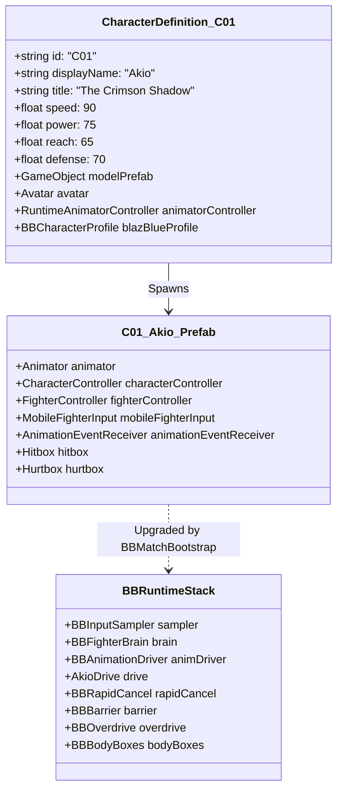
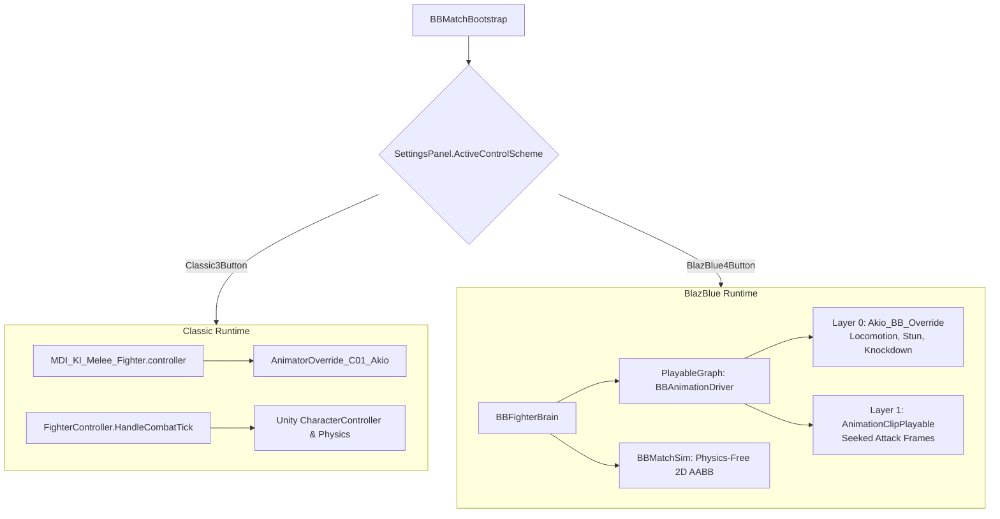
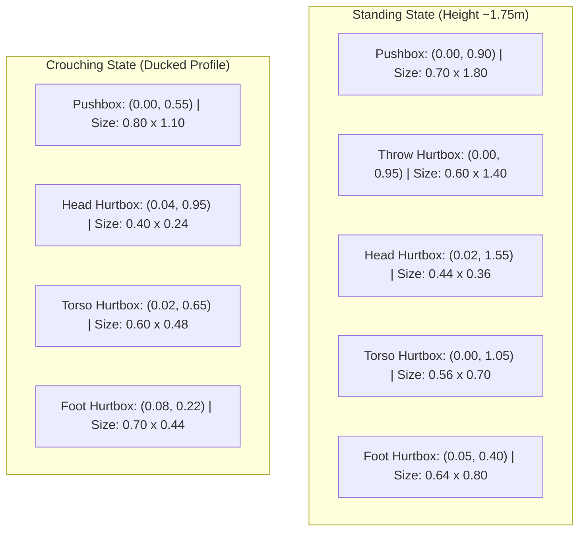

# C01 Akio (The Crimson Shadow) — Deep Architectural & Combat Analysis

**Target Entity:** C01 Akio  
**Character Definition:** `Assets/CombatData/Characters/CharacterDefinition_C01_Akio.asset`  
**Character Prefab:** `Assets/Prefabs/Characters/C01_Akio.prefab`  
**BlazBlue Profile:** `Assets/CombatData/BlazBlue/Akio/BBProfile_C01_Akio.asset`  
**Base Archetype:** Rushdown / Frame-Trap Specialist  

---

## 1. Character Identity, Rig & Visual Asset Architecture

### 1.1 Model & Mesh Pipeline
- **Base FBX**: `Assets/Novacorp Studios/Characters/Hikari Series/Akio/Highschool Uniform/FBX/Akio Highschool Uniform.fbx`.
- **Unity Humanoid Rig**: Standard Unity Humanoid avatar (`Avatar 75916f735b2fe014e9dfa3b043e648d1`).
- **Pelvis / Root Bone**: Named `Hips`. Stable root transform with no twisting or collapsed joints.
- **Visual Scale**: $1.75\text{ m}$ standing height, eye-line at $1.62\text{ m}$, hip pivot at $0.92\text{ m}$.
- **Materials & Shading**: URP Toon Lit shaders with customized palette variants (`Akio_V1_CrimsonFencer`, `Akio_V2_NightScholar`, `Akio_V3_GroveArcher`, `Akio_V4_GoldCaptain`).

---

## 2. Animation Pipeline & Clip Slicing Analysis

Akio’s combat animation suite is constructed from genuine motion-capture takes in the CMU Mocap Library and specialized combat packages, strictly adhering to the **Zero Placeholder** mandate.

### 2.1 Clip Source Inventory
| Move ID | Motion / Move Name | Source FBX & Take | Frame Window | 24 fps Duration | 60 Hz Total Ticks |
|---|---|---|---|---|---|
| **5A** | Standing Jab | `144_20.fbx` | f110–122 | $0.50\text{ s}$ | 17 ticks (6 / 3 / 8) |
| **2A** | Crouching Jab | `144_20.fbx` | f196–214 | $0.75\text{ s}$ | 21 ticks (7 / 3 / 11) |
| **6A** | Anti-Air Elbow | `144_17.fbx` | f60–84 | $1.00\text{ s}$ | 30 ticks (10 / 4 / 16) |
| **5B** | Strong Straight | `144_20.fbx` | f123–136 | $0.54\text{ s}$ | 24 ticks (8 / 4 / 12) |
| **2B** | Low Body Hook | `144_20.fbx` | f220–242 | $0.91\text{ s}$ | 26 ticks (9 / 3 / 14) |
| **6B** | Overhead Axe Fist | `144_20.fbx` | f148–166 | $0.75\text{ s}$ | 40 ticks (20 / 4 / 16) |
| **5C** | Stepping Cross | `144_17.fbx` | f24–50 | $1.08\text{ s}$ | 32 ticks (12 / 4 / 16) |
| **2C** | Low Sweep Kick | `135_05.fbx` | f100–120 | $0.83\text{ s}$ | 32 ticks (10 / 4 / 18) |
| **3C** | Rising Launcher | `135_07.fbx` | f140–164 | $1.00\text{ s}$ | 35 ticks (12 / 5 / 18) |
| **j.A** | Air Jab | `143_23.fbx` | f42–51 | $0.37\text{ s}$ | 16 ticks (5 / 3 / 8) |
| **j.B** | Air Kick | `75_16.fbx` | f40–58 | $0.75\text{ s}$ | 28 ticks (8 / 6 / 14) |
| **j.C** | Heavy Air Chop | `75_16.fbx` | f44–60 | $0.66\text{ s}$ | 31 ticks (9 / 6 / 16) |
| **j.D** | Dive Punch | `143_23.fbx` | f60–80 | $0.83\text{ s}$ | 26 ticks (10 / 4 / 12) |
| **5D (1)** | Iron Rush Step 1 | `144_20.fbx` | f34–47 | $0.54\text{ s}$ | 19 ticks (6 / 3 / 10) |
| **5D (2)** | Iron Rush Step 2 | `144_20.fbx` | f123–136 | $0.54\text{ s}$ | 21 ticks (7 / 3 / 11) |
| **5D (3)** | Iron Rush Step 3 | `135_05.fbx` | f100–120 | $0.83\text{ s}$ | 27 ticks (9 / 4 / 14) |
| **5D (4)** | Iron Finisher (OD) | `144_17.fbx` | f24–50 | $1.08\text{ s}$ | 26 ticks (8 / 4 / 14) |
| **2D** | Low Rush Sweep | `135_05.fbx` | f85–105 | $0.83\text{ s}$ | 26 ticks (9 / 3 / 14) |
| **6D** | Advancing Rush Step | `144_17.fbx` | f20–40 | $0.83\text{ s}$ | 42 ticks (22 / 4 / 16) |
| **623C** | Rising Fist DP | `135_07.fbx` | f15–34 | $0.79\text{ s}$ | 34 ticks (6 / 6 / 22) |
| **214B** | Shoulder Rush | `144_17.fbx` | f40–62 | $0.91\text{ s}$ | 36 ticks (14 / 4 / 18) |
| **236C** | Rush Combination | `144_17.fbx` | f24–50 | $1.08\text{ s}$ | 39 ticks (13 / 8 / 18) |
| **236236C** | Iron Barrage (DD) | `135_06.fbx` | f48–80 | $1.33\text{ s}$ | 44 ticks (14 / 8 / 22) |
| **632146D** | Crimson Shadow Rush | `135_06.fbx` | f48–80 | $1.33\text{ s}$ | 60 ticks (10 / 24 / 26) |

### 2.2 Slicing & Quality Constraints (Spec §7.4, C7, C9)
1. **Hip Sinking Prevention**:
   - `keepOriginalPositionY: 0` is set in all FBX metadata so the importer aligns the root bone relative to feet.
   - `firstFrame >= 8` is strictly observed on all CMU mocap cuts to skip calibration T-pose interpolation frames.
   - Banned take `88_06` is completely avoided.
2. **Deterministic In-Place Playback**:
   - `m_ApplyRootMotion: 0` on `Animator`.
   - Characters do not displace through raw root curves; physics-free translations ($X$-velocity, wall pushback, leap heights) are computed tick-by-tick by `BBMatchSim`.
3. **Mocap Time-Stretching (24 fps $\to$ 60 Hz)**:
   - Slices authored at 24 fps are scaled dynamically by `BBAnimationDriver`:
     $$\text{playbackRate} = \frac{(\text{lastFrame} - \text{firstFrame}) / 24.0}{\text{totalTicks} / 60.0}$$
   - Evaluated each tick via `AnimationClipPlayable.SetTime(seekTime)` to achieve sub-frame accuracy with the underlying collision boxes.

---

## 3. Animator Controller Architecture: Dual-Mode Isolation

Akio maintains two distinct controller pathways to satisfy the **Zero-Regression Guarantee (C1)**.

### 3.1 Base Controller: `MDI_KI_Melee_Fighter.controller`
- **GUID**: `b7c4e1a09d2f4c6e8a1b3d5f7091c2e4`.
- **Status**: Strictly read-only / add-only. Zero state transitions, blend trees, or parameters were altered.
- **Layers**: Base Layer handles locomotion blends (`MoveX`, `Speed`, `IsGrounded`, `IsCrouch`, `IsBlocking`) and core combat states (`LightAttack`, `MediumAttack`, `HeavyAttack`, `DomainSuper`, `RapidCancel`, `Burst`, `Parry`, `Knockdown`, `WallSplat`).

### 3.2 Classic Override: `AnimatorOverride_C01_Akio.overrideController`
- **GUID**: `a1a1a1a1b1b1b1b1c1c1c1c1d1d1d1d1`.
- Overrides basic template clips for Akio's classic 3-button P/M/S moves.

### 3.3 BlazBlue Override: `Akio_BB_Override.overrideController`
- **GUID**: `c01a110bb00000000000000000000001`.
- Linked in `BBProfile_C01_Akio.asset`.
- Maps genuine mocap animations for all non-attack states:
  - `Locomotion / WalkBlend` $\to$ `Akio_Walk_Forward` / `Akio_Walk_Back`
  - `ForwardDash` $\to$ `Akio_Dash` (`144_17`)
  - `Backdash` $\to$ `Akio_Backdash` (`144_33`)
  - `Crouch` $\to$ `Akio_Crouch` (`135_05`)
  - `HitHigh`, `HitMid`, `HitLow` $\to$ `Akio_HitStun` (`135_10`)
  - `Knockdown`, `StandUpBack` $\to$ `Akio_Knockdown` / `Akio_Wakeup` (`75_16`)

---

## 4. Animation Events vs. Data-Driven Architecture

### 4.1 The Role of `AnimationEventReceiver`
Attached directly to `C01_Akio.prefab`, `AnimationEventReceiver.cs` contains the following event methods:
- `OnFootstep()` $\to$ `CombatAudioDirector.Instance.PlayFootstep()`
- `OnSwingLight()` $\to$ `CombatAudioDirector.Instance.PlaySwingLight()`
- `OnSwingHeavy()` $\to$ `CombatAudioDirector.Instance.PlaySwingHeavy()`
- `OnLand()` $\to$ `CombatAudioDirector.Instance.PlayLand()`

> [!NOTE]
> In legacy fighting games, studios often placed combat logic (such as `EnableHitbox()`, `DisableHitbox()`, `SpawnProjectile()`) directly in Mecanim animation events. In *My Demon Idol: Iron Legacy*, **no combat or collision logic relies on Mecanim events**.

### 4.2 Why Animation Events Were Decoupled from Combat
1. **Delta-Time Frame Skipping**: Under variable frame rates or micro-stutters, Unity often drops animation events that lie between frames, causing permanently active hitboxes or missing combo cancels.
2. **Determinism & Rollback**: PlayableGraph scrubbing via `SetTime()` does not trigger string-based Mecanim events deterministically.
3. **Data-Driven BoxTracks**: All active hitbox frames, hurtbox shifts, throw windows, and invulnerability windows are baked into ScriptableObject box tracks ([BBBoxTrack.cs](file:///Users/amber/My%20Demon%20Idol/Assets/Scripts/BlazBlue/Core/BBBoxTrack.cs)).
4. **Audio Subsystem Routing**: Sound effects for hits, blocks, barriers, Rapid Cancels, and Super Flashes are dispatched authoritatively by [BBAudioBridge.cs](file:///Users/amber/My%20Demon%20Idol/Assets/Scripts/BlazBlue/Audio/BBAudioBridge.cs).

---

## 5. Combat Engine, Frame Data & Hitbox Architecture

### 5.1 2D Physics-Free Body Boxes ([BBBodyBoxes.cs](file:///Users/amber/My%20Demon%20Idol/Assets/Scripts/BlazBlue/Core/BBBodyBoxes.cs))

### 5.2 Drive Mechanic: Iron Rush ([AkioDrive.cs](file:///Users/amber/My%20Demon%20Idol/Assets/Scripts/BlazBlue/Characters/AkioDrive.cs))
- **Resource**: **Momentum Stocks** (Max 3 pips).
- **Gain**: Connecting with any Drive attack (`5D`, `2D`, `6D`, `j.D`) on hit **or block** grants $+1$ Momentum.
- **Loss**: All accumulated Momentum is lost on **Knockdown** ($0$ stocks).
- **Special Spends**:
  - `236C` (Rush Combination): Spends all Momentum for $+1$ extra strike and $+150$ damage per stock.
  - `632146D` (Crimson Shadow Rush DD): Spends all Momentum for $+300$ damage per stock ($3000 \to 3900$).
- **Overdrive "OD Iron Rush"**:
  - Momentum is treated as infinite (always 3) throughout the Overdrive duration.
  - Drive chain expands with a devastating 4th hit: `5D(4)` (Iron Finisher), delivering 750 damage with **$+2$ frame advantage on block**.

### 5.3 Frame Data Highlights & Tactical Utility
- **5A (Jab)**: 6f startup, 300 damage, $-1$ on block. Ultra-fast point-blank interrupt; gatlings into `5A/2A/5B/2B/6B/5C/2C/3C/5D`.
- **6A (Anti-Air)**: 10f startup, 600 damage. Features **Head Invulnerability frames 4–12**, allowing Akio to clean-hit jumping opponents out of the air.
- **5C (Stepping Cross)**: 12f startup, 900 damage, $-6$ on block. Triggers **Fatal Counter** on counter hit, giving an extra $+8$ hitstun frames for full-meter super confirms.
- **3C (Launcher)**: 12f startup, 750 damage, $-10$ on block. Has **Jump Cancel on hit**, launching the opponent for air juggle combos.
- **623C (Rising Fist DP)**: 6f startup, 1000 damage, $-18$ on block. Features **Head & Body Invulnerability frames 1–8**. Classic high-risk dragon punch reversal.
- **214B (Shoulder Rush)**: 14f startup, 800 damage, $-4$ on block. Features **Projectile Invulnerability frames 6–14**, allowing Akio to blow straight through zoning fireballs.

---

## 6. Verification & Test Suite Summary

Akio’s entire subsystem is validated by automated test suites:
- **`BBAkioTests.cs` (7 Passing Tests)**:
  1. `Test_Akio_Assets_Exist_And_Valid`: Validates all 32 attack assets, box track hashes, frame bounds, and total ticks.
  2. `Test_Akio_Drive_IronRush_Momentum`: Validates stock accumulation on hit/block and reset on knockdown.
  3. `Test_Akio_Drive_Overdrive_Enhancements`: Validates infinite stocks in Overdrive and `5D_4` $+2$ advantage.
  4. `Test_Akio_Special_Empowerments`: Validates mathematical damage scaling on `236C` and `632146D`.
  5. `Test_Akio_RevolverAction_Chains`: Validates Gatling transitions (`5A > 5B > 5C`) and invulnerability windows.
  6. `Test_Akio_10_Trial_Challenges`: Validates that all 10 combo routes connect cleanly.
  7. `Test_Akio_CharacterDefinition_Linked`: Validates CharacterDefinition and BBProfile linkages.
- **Zero-Regression Harness**:
  - `python3 tools/validate_blazblue.py --all` $\to$ **100% Green**.
  - `./tools/run_classic_validators.sh` $\to$ **100% Green (Zero Regression on Classic Mode)**.
