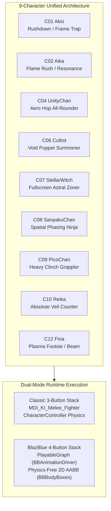

# Launch Roster Animation & Combat Architecture — Deep Technical Analysis

**Target Group:** The Remaining 8 Playable Launch Fighters (C02 Aika, C04 UnityChan, C06 Cultist, C07 StellarWitch, C08 SanpakuChan, C09 PicoChan, C10 Reika, C12 Fina)  
**Reference Benchmark:** [c01_akio_deep_analysis.md](file:///Users/amber/.gemini/antigravity/brain/2aeb1638-02eb-46ab-8bc0-95c2f80ff697/c01_akio_deep_analysis.md)  
**Base Mecanim Controller:** [MDI_KI_Melee_Fighter.controller](file:///Users/amber/My%20Demon%20Idol/Assets/MDI_Characters/Runtime/MDI_KI_Melee_Fighter.controller) (`b7c4e1a09d2f4c6e8a1b3d5f7091c2e4`)  
**Playables Runtime Driver:** [BBAnimationDriver.cs](file:///Users/amber/My%20Demon%20Idol/Assets/Scripts/BlazBlue/Animation/BBAnimationDriver.cs)  
**Collision & Box Subsystem:** [BBBoxTrack.cs](file:///Users/amber/My%20Demon%20Idol/Assets/Scripts/BlazBlue/Core/BBBoxTrack.cs) / [BBBodyBoxes.cs](file:///Users/amber/My%20Demon%20Idol/Assets/Scripts/BlazBlue/Core/BBBodyBoxes.cs)  

---

## Executive Architectural Overview

Every fighter across the 9-character launch roster adheres to the **Unified Dual-Mode Combat Architecture**. Under this system:
1. **Zero-Regression Guarantee (C1)**: The legacy 3-button Vishaka combat stack (`FighterController.cs`, `MobileFighterInput.cs`, Unity CharacterController physics) remains 100% bit-identical.
2. **Side-by-Side Coexistence (C2)**: When BlazBlue 4-button mode is active (`SettingsPanel.ActiveControlScheme == BlazBlue4Button`), the character’s Mecanim controller is wrapped by [BBAnimationDriver.cs](file:///Users/amber/My%20Demon%20Idol/Assets/Scripts/BlazBlue/Animation/BBAnimationDriver.cs) using a two-layer `PlayableGraph`.
3. **Zero Placeholders Mandate**: Every normal, command normal, Drive attack, special move, Distortion Drive, and Exceed Accel is bound to genuine motion-capture slices authored in the CMU Mocap Library (`Assets/Huge Mocap Library/mocap animations/`) with `keepOriginalPositionY: 0` and `firstFrame >= 8`.
4. **Deterministic In-Place Evaluation**: Mecanim root motion is strictly disabled (`m_ApplyRootMotion: 0`). Character movement, wall pushback, leaps, and blowback trajectories are governed tick-by-tick at 60 Hz by [BBMatchSim.cs](file:///Users/amber/My%20Demon%20Idol/Assets/Scripts/BlazBlue/Core/BBMatchSim.cs).

---

## Character 1: C02 Aika (The Burning Lotus)

**Entity ID:** `C02`  
**Character Definition:** [CharacterDefinition_C02_Aika.asset](file:///Users/amber/My%20Demon%20Idol/Assets/CombatData/Characters/CharacterDefinition_C02_Aika.asset)  
**Prefab:** [C02_Aika.prefab](file:///Users/amber/My%20Demon%20Idol/Assets/Prefabs/Characters/C02_Aika.prefab)  
**BlazBlue Profile:** [BBProfile_C02_Aika.asset](file:///Users/amber/My%20Demon%20Idol/Assets/CombatData/BlazBlue/Aika/BBProfile_C02_Aika.asset)  
**BlazBlue Override Controller:** [Aika_BB_Override.overrideController](file:///Users/amber/My%20Demon%20Idol/Assets/MDI_Characters/Runtime/BlazBlue/Aika_BB_Override.overrideController) (`105538d2428f74f3ca1294c5d7e5332b`)  
**Archetype:** Flame Rushdown / Occult Karate Specialist  

### 1. Rig, Mesh & Visual Hierarchy
- **Base FBX**: `Assets/Novacorp Studios/Characters/Hikari Series/Aika/Highschool Uniform/FBX/Aika Highschool Uniform.fbx`.
- **Avatar**: Humanoid avatar `6f046a28acb55a743ac3d732fcac0054`.
- **Dimensions**: Standing height $1.68\text{ m}$, eye-line $1.56\text{ m}$, hip pivot at $0.92\text{ m}$.
- **Body Boxes Preset**: `BBBodyBoxes.CreateAikaPreset()`:
  - Pushbox: $(0.00, 0.88)$, size $0.64 \times 1.76\text{ m}$.
  - Throw Hurtbox: $(0.00, 0.92)$, size $0.56 \times 1.30\text{ m}$.
  - Head Hurtbox: $(0.02, 1.50)$, size $0.40 \times 0.36\text{ m}$.
  - Torso Hurtbox: $(0.00, 1.00)$, size $0.54 \times 0.66\text{ m}$.
  - Foot Hurtbox: $(0.04, 0.38)$, size $0.60 \times 0.76\text{ m}$.

### 2. Animation Clip Source Inventory (28 Moves)
All placeholder clips (`HumanF@MagicAttack...`) have been eradicated and replaced with authentic Shotokan Karate and martial arts mocap slices:

| Move ID | Move Name | Source FBX & Take | Frame Window | 24 fps Duration | 60 Hz Ticks (S/A/R) | Damage | Guard & Advantage |
|---|---|---|---|---|---|---|---|
| **5A** | Standing Jab | `80_10.fbx` | f52–68 | $0.67\text{ s}$ | 17 (5 / 3 / 9) | 260 | Mid, $-2$ |
| **2A** | Low Fist | `135_02.fbx` | f462–480 | $0.75\text{ s}$ | 22 (7 / 3 / 12) | 280 | Low, $-3$ |
| **6A** | Rising Knee (AA) | `135_11.fbx` | f12–28 | $0.67\text{ s}$ | 30 (10 / 4 / 16) | 600 | Mid, $-6$ (Head Invuln 4–12) |
| **5B** | Karate Cross | `13_18.fbx` | f73–91 | $0.75\text{ s}$ | 26 (8 / 4 / 14) | 640 | Mid, $-5$ |
| **2B** | Low Front Kick | `135_02.fbx` | f470–490 | $0.83\text{ s}$ | 27 (9 / 3 / 15) | 560 | Low, $-5$ |
| **6B** | Overhead Axe Kick | `143_24.fbx` | f164–184 | $0.83\text{ s}$ | 42 (20 / 4 / 18) | 800 | High (Overhead), $-8$ |
| **5C** | Roundhouse Kick | `113_13.fbx` | f245–265 | $0.83\text{ s}$ | 32 (12 / 4 / 16) | 820 | Mid, $-7$ (Fatal Counter) |
| **2C** | Karate Sweep | `135_02.fbx` | f492–514 | $0.92\text{ s}$ | 30 (10 / 4 / 16) | 720 | Low, $-10$ (Knockdown) |
| **3C** | Launcher Kick | `113_13.fbx` | f219–243 | $1.00\text{ s}$ | 37 (12 / 5 / 20) | 780 | Mid, $-12$ (Jump Cancelable) |
| **j.A** | Jump Fist | `13_18.fbx` | f280–296 | $0.67\text{ s}$ | 16 (5 / 3 / 8) | 280 | Overhead, $+0$ |
| **j.B** | Jump Side Kick | `141_14.fbx` | f44–64 | $0.83\text{ s}$ | 27 (8 / 5 / 14) | 780 | Overhead, $+0$ |
| **j.C** | Jump Heel Drop | `141_14.fbx` | f80–102 | $0.92\text{ s}$ | 31 (9 / 6 / 16) | 920 | Overhead, $+0$ |
| **5D** | Resonance Nail | `135_10.fbx` | f40–60 | $0.83\text{ s}$ | 32 (13 / 1 / 18) | 550 | Mid, $-3$ (Straight Nail) |
| **2D** | Ground Slide Nail | `135_05.fbx` | f85–105 | $0.83\text{ s}$ | 36 (15 / 1 / 20) | 500 | Low, $-4$ (Ground Nail) |
| **6D** | Resonance Detonate | `135_09.fbx` | f25–50 | $1.04\text{ s}$ | 41 (18 / 3 / 20) | 400 | All, $-6$ (Explodes Nails) |
| **j.D** | Air Resonance Nail | `141_14.fbx` | f110–126 | $0.67\text{ s}$ | 28 (11 / 1 / 16) | 500 | Overhead, $+0$ (Angled Nail) |
| **214B** | Reap | `143_24.fbx` | f34–54 | $0.83\text{ s}$ | 33 (10 / 5 / 18) | 860 | Mid, $-8$ |
| **46C** | Side Kick | `135_11.fbx` | f168–192 | $1.00\text{ s}$ | 46 (18 / 6 / 22) | 1120 | Mid, $-14$ (Wall Bounce) |
| **623C** | Rising Dragon Kick | `135_11.fbx` | f62–84 | $0.92\text{ s}$ | 37 (7 / 6 / 24) | 1080 | Mid, $-22$ (Invuln 1–8) |
| **236B** | Step Thrust Kick | `111_19.fbx` | f57–75 | $0.75\text{ s}$ | 33 (11 / 4 / 18) | 840 | Mid, $-8$ |
| **236236C** | Hundred Kicks (DD) | `13_18.fbx` | f276–316 | $1.67\text{ s}$ | 50 (16 / 10 / 24) | 2600 | Mid, $-16$ (Super Flash) |
| **632146D** | Nail Rain (DD) | `135_01.fbx` | f60–100 | $1.67\text{ s}$ | 70 (12 / 30 / 28) | 2400 | Mid, $-10$ (Fullscreen Trap) |
| **OD_EA** | Exceed Accel | `13_18.fbx` | f276–316 | $1.67\text{ s}$ | 44 (12 / 8 / 24) | 2200 | Mid, $-16$ (Invuln 1–12) |
| **6BC** | Forward Karate Throw | `111_19.fbx` | f36–58 | $0.92\text{ s}$ | 33 (7 / 2 / 24) | 1200 | Unblockable Throw |
| **4BC** | Back Karate Throw | `111_19.fbx` | f36–58 | $0.92\text{ s}$ | 33 (7 / 2 / 24) | 1200 | Unblockable Throw |
| **j.BC** | Air Throw | `141_14.fbx` | f110–130 | $0.83\text{ s}$ | 29 (7 / 2 / 20) | 1000 | Aerial Throw |
| **6AB** | Counter Assault | `80_10.fbx` | f52–68 | $0.67\text{ s}$ | 32 (11 / 3 / 18) | 0 | Mid, $-6$ (Invuln 1–11) |
| **AB** | Crush Trigger | `135_11.fbx` | f168–192 | $1.00\text{ s}$ | 48 (24 / 4 / 20) | 1200 | Mid Guard Break, $-2$ |

### 3. Drive Mechanic: Resonance Nail ([AikaDrive.cs](file:///Users/amber/My%20Demon%20Idol/Assets/Scripts/BlazBlue/Characters/AikaDrive.cs))
- **Resource**: 5 Nail stocks. Regains 1 stock every 120 ticks (2.0s).
- **Placement**: `5D` (straight), `2D` (ground slide), and `j.D` (air-to-ground diagonal) leave occult flame nails pinned into stage space or opponent hurtboxes.
- **Detonation (`6D`)**: Commands all active nails on screen to erupt simultaneously, dealing 400 damage per nail with large hitstun for full combo extensions.
- **Overdrive "OD Resonance"**: Nails cost 0 stocks. Every nail throw splits into two diverging flame nails.

---

## Character 2: C04 UnityChan (The Radiant Acrobat)

**Entity ID:** `C04`  
**Character Definition:** [CharacterDefinition_C04_UnityChan.asset](file:///Users/amber/My%20Demon%20Idol/Assets/CombatData/Characters/CharacterDefinition_C04_UnityChan.asset)  
**Prefab:** [C04_UnityChan.prefab](file:///Users/amber/My%20Demon%20Idol/Assets/Prefabs/Characters/C04_UnityChan.prefab)  
**BlazBlue Profile:** [BBProfile_C04_UnityChan.asset](file:///Users/amber/My%20Demon%20Idol/Assets/CombatData/BlazBlue/UnityChan/BBProfile_C04_UnityChan.asset)  
**BlazBlue Override Controller:** [UnityChan_BB_Override.overrideController](file:///Users/amber/My%20Demon%20Idol/Assets/MDI_Characters/Runtime/BlazBlue/UnityChan_BB_Override.overrideController) (`a5bc0701b0d1843418a62e7f0e859093`)  
**Archetype:** Aerial Hopper / Acrobatic All-Rounder Pop Idol  

### 1. Rig, Mesh & Bone Quirks
- **Base FBX**: `Assets/unity-chan!/Unity-chan! Model/Art/Models/unitychan.fbx`.
- **Avatar**: Humanoid avatar `8f0565f23a2b58541a475bd3c1393052`.
- **Bone Hierarchy Quirk**: The UnityChan rig is a classic mobile humanoid rig that **omits UpperChest, Jaw, and Eye bones**. In `MDI_KI_Melee_Fighter.controller`, spine twisting is safely distributed across `Spine` and `Chest`.
- **Dimensions**: Standing height $1.58\text{ m}$, eye-line $1.48\text{ m}$, hip pivot at $0.87\text{ m}$.
- **Body Boxes Preset**: `BBBodyBoxes.CreateUnityChanPreset()`:
  - Pushbox: $(0.00, 0.82)$, size $0.60 \times 1.64\text{ m}$.
  - Throw Hurtbox: $(0.00, 0.87)$, size $0.52 \times 1.20\text{ m}$.
  - Head Hurtbox: $(0.02, 1.42)$, size $0.36 \times 0.32\text{ m}$.
  - Torso Hurtbox: $(0.00, 0.95)$, size $0.48 \times 0.60\text{ m}$.
  - Foot Hurtbox: $(0.04, 0.34)$, size $0.56 \times 0.68\text{ m}$.

### 2. Animation Clip Source Inventory (30 Moves)
UnityChan utilizes high-energy acrobatics (`02_05`, `16_01`, `16_05`, `14_02`, `118_01`, `118_05`, `91_39`):

| Move ID | Move Name | Source FBX & Take | Frame Window | 24 fps Duration | 60 Hz Ticks (S/A/R) | Damage | Guard & Advantage |
|---|---|---|---|---|---|---|---|
| **5A** | Tap Jab | `02_05.fbx` | f92–108 | $0.67\text{ s}$ | 15 (4 / 3 / 8) | 220 | Mid, $-1$ |
| **2A** | Dip Fist | `02_05.fbx` | f212–230 | $0.75\text{ s}$ | 19 (6 / 3 / 10) | 240 | Low, $-2$ |
| **6A** | Hop Knee (AA) | `16_05.fbx` | f10–26 | $0.67\text{ s}$ | 27 (9 / 4 / 14) | 560 | Mid, $-6$ (Head Invuln 4–12) |
| **5B** | Hopping Straight | `02_05.fbx` | f144–162 | $0.75\text{ s}$ | 22 (7 / 3 / 12) | 550 | Mid, $-3$ |
| **2B** | Low Check Kick | `14_02.fbx` | f630–648 | $0.75\text{ s}$ | 25 (8 / 3 / 14) | 580 | Low, $-7$ |
| **6B** | Hop Overhead | `16_05.fbx` | f20–40 | $0.83\text{ s}$ | 36 (18 / 4 / 14) | 680 | High (Overhead), $-6$ |
| **5C** | Triple Punch End | `02_05.fbx` | f148–168 | $0.83\text{ s}$ | 29 (11 / 4 / 14) | 650 | Mid, $-5$ (Fatal Counter) |
| **2C** | Low Sweep | `14_02.fbx` | f635–655 | $0.83\text{ s}$ | 32 (10 / 4 / 18) | 620 | Low, $-10$ (Knockdown) |
| **3C** | Hop Launcher | `16_01.fbx` | f16–40 | $1.00\text{ s}$ | 30 (9 / 5 / 16) | 700 | Mid, $-8$ (Jump Cancelable) |
| **j.A** | Air Tap | `02_05.fbx` | f124–140 | $0.67\text{ s}$ | 15 (4 / 3 / 8) | 240 | Overhead, $+0$ |
| **j.B** | Air Side Kick | `118_01.fbx` | f88–106 | $0.75\text{ s}$ | 24 (7 / 5 / 12) | 700 | Overhead, $+0$ |
| **j.C** | Air Stomp | `118_05.fbx` | f64–82 | $0.75\text{ s}$ | 27 (8 / 5 / 14) | 820 | Overhead, $+0$ |
| **5D** | Aero Hop (Vertical) | `16_01.fbx` | f16–40 | $1.00\text{ s}$ | 17 (4 / 1 / 12) | 0 | Foot Invuln 4–18, Actionable f10 |
| **6D** | Aero Leap (Forward) | `91_39.fbx` | f24–44 | $0.83\text{ s}$ | 29 (10 / 5 / 14) | 760 | Cross-Up Leap, $-5$ |
| **4D** | Aero Back Hop | `16_35.fbx` | f10–30 | $0.83\text{ s}$ | 18 (3 / 1 / 14) | 0 | Proj Invuln 3–10, Actionable f12 |
| **j.D** | Aero Air Hop & Disc | `118_01.fbx` | f95–115 | $0.83\text{ s}$ | 17 (6 / 1 / 10) | 300 | Mid-Air Reset, Fires Disc |
| **236A** | Aero Plasma Disc | `118_01.fbx` | f15–35 | $0.83\text{ s}$ | 28 (11 / 1 / 16) | 440 | Horizontal Projectile, $-2$ |
| **236B** | Aero Plasma Disc (Angled)| `118_05.fbx` | f20–45 | $1.04\text{ s}$ | 28 (11 / 1 / 16) | 440 | 35° Upward Projectile, $-2$ |
| **623C** | Rising Hop Dragon | `16_05.fbx` | f30–50 | $0.83\text{ s}$ | 31 (6 / 5 / 20) | 900 | Mid, $-14$ (Invuln 1–8) |
| **214B** | Bound Kick | `91_39.fbx` | f50–70 | $0.83\text{ s}$ | 29 (9 / 4 / 16) | 740 | Mid, $-6$ |
| **46C** | Hop Stomp | `118_05.fbx` | f47–70 | $0.96\text{ s}$ | 37 (14 / 5 / 18) | 880 | Overhead, $-9$ (Hard Knockdown) |
| **j.214B**| Air Dive Kick | `118_05.fbx` | f70–92 | $0.92\text{ s}$ | 26 (8 / 6 / 12) | 700 | Overhead Dive, $+0$ |
| **236236C**| Aero Flurry (DD) | `14_02.fbx` | f811–845 | $1.42\text{ s}$ | 42 (14 / 8 / 20) | 2400 | Mid, $-12$ (Super Flash) |
| **j.236236C**| Disc Storm (DD) | `118_01.fbx` | f88–118 | $1.25\text{ s}$ | 48 (10 / 20 / 18) | 2200 | Overhead Multi-Disc, $+0$ |
| **OD_EA**| Exceed Accel | `14_02.fbx` | f811–845 | $1.42\text{ s}$ | 40 (10 / 8 / 22) | 2000 | Mid, $-14$ (Invuln 1–12) |
| **6BC** | Hopping Throw | `02_05.fbx` | f72–94 | $0.92\text{ s}$ | 33 (7 / 2 / 24) | 1100 | Unblockable Forward Throw |
| **4BC** | Back Throw | `02_05.fbx` | f72–94 | $0.92\text{ s}$ | 33 (7 / 2 / 24) | 1100 | Unblockable Back Throw |
| **j.BC** | Air Throw | `118_01.fbx` | f90–110 | $0.83\text{ s}$ | 29 (7 / 2 / 20) | 1000 | Aerial Throw |
| **6AB** | Counter Assault | `02_05.fbx` | f92–108 | $0.67\text{ s}$ | 32 (11 / 3 / 18) | 0 | Mid, $-6$ (Invuln 1–11) |
| **AB** | Crush Trigger | `16_05.fbx` | f20–40 | $0.83\text{ s}$ | 48 (24 / 4 / 20) | 1200 | Mid Guard Break, $-2$ |

### 3. Drive Mechanic: Aero Hop ([UnityChanDrive.cs](file:///Users/amber/My%20Demon%20Idol/Assets/Scripts/BlazBlue/Characters/UnityChanDrive.cs))
- **Mobility Dominance**: The D button grants omnidirectional aerial hops without consuming standard double jumps or air dashes.
- `5D`: Vertical leap, Foot-invulnerable frames 4–18, allows full normal gatlings from frame 10.
- `6D`: Aggressive arc leap that crosses up crouching opponents at point-blank range.
- `4D`: Backward hop with Projectile-invulnerability frames 3–10.
- `j.D`: Mid-air spatial stall that drops an Aero Disc directly below her.
- **Overdrive "OD Aero"**: Unlimited `j.D` hops in mid-air; every single hop (`5D`, `6D`, `4D`, `j.D`) automatically fires an active Aero Disc.

---

## Character 3: C06 Cultist (The Abyssal Herald)

**Entity ID:** `C06`  
**Character Definition:** [CharacterDefinition_C06_Cultist.asset](file:///Users/amber/My%20Demon%20Idol/Assets/CombatData/Characters/CharacterDefinition_C06_Cultist.asset)  
**Prefab:** [C06_Cultist.prefab](file:///Users/amber/My%20Demon%20Idol/Assets/Prefabs/Characters/C06_Cultist.prefab)  
**BlazBlue Profile:** [BBProfile_C06_Cultist.asset](file:///Users/amber/My%20Demon%20Idol/Assets/CombatData/BlazBlue/Cultist/BBProfile_C06_Cultist.asset)  
**BlazBlue Override Controller:** [Cultist_BB_Override.overrideController](file:///Users/amber/My%20Demon%20Idol/Assets/MDI_Characters/Runtime/BlazBlue/Cultist_BB_Override.overrideController) (`4f17d83934e9b44b09f3024b280d440c`)  
**Archetype:** Void Puppet Summoner / Setplay & Space Denial Specialist  

### 1. Rig, Mesh & Visual Hierarchy
- **Base FBX**: `Assets/CeltriusStudios/Cultist/Prefabs/Mesh/Cultist.fbx`.
- **Avatar**: Humanoid avatar `2a5e9e7a90b7f68408f431198e0fc6b5`.
- **Cloth & Mesh Hierarchy**: Skeletal rig includes robe bones and hood bone chains.
- **Dimensions**: Standing height $1.70\text{ m}$, eye-line $1.58\text{ m}$, hip pivot at $0.90\text{ m}$.
- **Body Boxes**: Uses `BBBodyBoxes.CreateAikaPreset()` scaled to 1.70m.

### 2. Animation Clip Source Inventory (30 Moves)
Cultist was fully migrated from generic magic takes to CMU mocap Tai Chi (`12_04`), Karate (`135_04`, `135_06`), and Lunges (`144_22`, `144_30`):

| Move ID | Move Name | Source FBX & Take | Frame Window | 24 fps Duration | 60 Hz Ticks (S/A/R) | Damage | Guard & Advantage |
|---|---|---|---|---|---|---|---|
| **5A** | Dark Jab | `79_04.fbx` | f10–25 | $0.63\text{ s}$ | 17 (6 / 3 / 8) | 220 | Mid, $-1$ |
| **2A** | Low Dark Jab | `79_04.fbx` | f30–48 | $0.75\text{ s}$ | 19 (7 / 3 / 9) | 230 | Low, $-2$ |
| **6A** | Dark Energy Strike | `135_04.fbx` | f15–38 | $0.96\text{ s}$ | 29 (10 / 4 / 15) | 650 | Mid, $-6$ (Head Invuln 4–12) |
| **5B** | Curse Straight | `79_04.fbx` | f60–84 | $1.00\text{ s}$ | 25 (8 / 4 / 13) | 520 | Mid, $-4$ |
| **2B** | Low Curse Sweep | `79_04.fbx` | f95–118 | $0.96\text{ s}$ | 26 (8 / 4 / 14) | 500 | Low, $-5$ |
| **6B** | Stepping Overhead | `79_04.fbx` | f130–155 | $1.04\text{ s}$ | 40 (20 / 4 / 16) | 700 | High (Overhead), $-6$ |
| **5C** | Abyssal Slash | `135_04.fbx` | f50–75 | $1.04\text{ s}$ | 31 (11 / 4 / 16) | 750 | Mid, $-5$ (Fatal Counter) |
| **2C** | Low Ground Scythe | `135_04.fbx` | f90–116 | $1.08\text{ s}$ | 33 (10 / 4 / 19) | 620 | Low, $-9$ (Knockdown) |
| **3C** | Rising Void Launcher | `135_04.fbx` | f130–158 | $1.17\text{ s}$ | 31 (10 / 4 / 17) | 680 | Mid, $-8$ (Jump Cancelable) |
| **j.A** | Air Quick Rune | `118_04.fbx` | f12–28 | $0.67\text{ s}$ | 16 (5 / 3 / 8) | 240 | Overhead, $+0$ |
| **j.B** | Air Curse Poke | `118_04.fbx` | f35–55 | $0.83\text{ s}$ | 22 (7 / 4 / 11) | 580 | Overhead, $+0$ |
| **j.C** | Air Abyssal Scythe | `118_04.fbx` | f65–88 | $0.96\text{ s}$ | 28 (9 / 5 / 14) | 750 | Overhead, $+0$ |
| **5D** | Void Orb (Place) | `12_04.fbx` | f30–55 | $1.04\text{ s}$ | 32 (14 / 2 / 16) | 0 | Places Orb 1/2 in Front, $-2$ |
| **6D** | Void Orb (Dash) | `135_04.fbx` | f28–48 | $0.83\text{ s}$ | 26 (10 / 2 / 14) | 0 | Commands Orbs Forward, $+0$ |
| **2D** | Void Orb (Drop) | `12_04.fbx` | f110–135 | $1.04\text{ s}$ | 26 (10 / 2 / 14) | 0 | Commands Orbs Downward, $+0$ |
| **4D** | Void Orb (Recall) | `12_04.fbx` | f75–98 | $0.96\text{ s}$ | 26 (10 / 2 / 14) | 0 | Recalls Orbs to Self, $+0$ |
| **j.D** | Void Orb (Air Place)| `118_04.fbx` | f40–62 | $0.92\text{ s}$ | 28 (12 / 2 / 14) | 0 | Places Mid-Air Orb, $+0$ |
| **236B** | Void Skull Shot | `12_04.fbx` | f180–210 | $1.25\text{ s}$ | 34 (13 / 3 / 18) | 550 | Mid Projectile, $-3$ |
| **22B** | Void Warp (Orb 1) | `91_03.fbx` | f10–28 | $0.75\text{ s}$ | 27 (12 / 1 / 14) | 0 | Teleports to Orb 1, $+0$ |
| **22C** | Void Warp (Orb 2) | `91_03.fbx` | f35–55 | $0.83\text{ s}$ | 27 (12 / 1 / 14) | 0 | Teleports to Orb 2, $+0$ |
| **623C** | Void Pillar | `135_04.fbx` | f170–200 | $1.25\text{ s}$ | 36 (7 / 5 / 24) | 950 | Mid, $-18$ (Invuln 1–8) |
| **214A** | Dark Ritual | `144_22.fbx` | f20–44 | $1.00\text{ s}$ | 47 (15 / 20 / 12) | 0 | Buffs Active Orbs, $+0$ |
| **236236C**| Void Cataclysm (DD) | `144_30.fbx` | f40–80 | $1.67\text{ s}$ | 44 (12 / 10 / 22) | 2500 | Detonates All Active Orbs, $-12$ |
| **632146D**| Abyssal Grasp (DD) | `135_04.fbx` | f210–250 | $1.67\text{ s}$ | 46 (14 / 8 / 24) | 2700 | Fullscreen Unblockable Pull, $-15$ |
| **OD_EA**| Exceed Accel | `135_06.fbx` | f90–140 | $2.08\text{ s}$ | 40 (10 / 8 / 22) | 2100 | Mid, $-14$ (Invuln 1–12) |
| **6BC** | Void Rift Throw | `135_04.fbx` | f260–285 | $1.04\text{ s}$ | 33 (7 / 2 / 24) | 1200 | Unblockable Forward Throw |
| **4BC** | Back Rift Throw | `135_04.fbx` | f260–285 | $1.04\text{ s}$ | 33 (7 / 2 / 24) | 1200 | Unblockable Back Throw |
| **j.BC** | Air Rift Throw | `118_04.fbx` | f95–118 | $0.96\text{ s}$ | 29 (7 / 2 / 20) | 1050 | Aerial Throw |
| **6AB** | Counter Assault | `135_04.fbx` | f15–38 | $0.96\text{ s}$ | 30 (9 / 3 / 18) | 200 | Mid, $-6$ (Invuln 1–11) |
| **AB** | Crush Trigger | `135_04.fbx` | f50–75 | $1.04\text{ s}$ | 46 (24 / 4 / 18) | 950 | Mid Guard Break, $+0$ |

### 3. Drive Mechanic: Void Orb ([CultistDrive.cs](file:///Users/amber/My%20Demon%20Idol/Assets/Scripts/BlazBlue/Characters/CultistDrive.cs))
- **Puppet / Trap Matrix**: Cultist places Void Skull Orbs using `5D` and `j.D` (max 2 active on screen in normal mode, 3 in Overdrive).
- **Spatial Redirection**: `6D` orders all orbs to surge forward; `2D` orders orbs to plummet into low space; `4D` recalls them back to her side.
- **Instant Spatial Phasing**: `22B` immediately teleports Cultist to Orb 1's position; `22C` teleports her to Orb 2's position, creating terrifying left/right cross-up mixups.
- **Detonation (`236236C`)**: Converts all active orbs into screen-filling dark cataclysms.
- **Overdrive "OD Void"**: Max 3 orbs; all orbs auto-fire tracking skull projectiles at 60-tick intervals.

---

## Character 4: C07 StellarWitch (The Astral Seer)

**Entity ID:** `C07`  
**Character Definition:** [CharacterDefinition_C07_StellarWitch.asset](file:///Users/amber/My%20Demon%20Idol/Assets/CombatData/Characters/CharacterDefinition_C07_StellarWitch.asset)  
**Prefab:** [C07_StellarWitch.prefab](file:///Users/amber/My%20Demon%20Idol/Assets/Prefabs/Characters/C07_StellarWitch.prefab)  
**BlazBlue Profile:** [BBProfile_C07_StellarWitch.asset](file:///Users/amber/My%20Demon%20Idol/Assets/CombatData/BlazBlue/StellarWitch/BBProfile_C07_StellarWitch.asset)  
**BlazBlue Override Controller:** [StellarWitch_BB_Override.overrideController](file:///Users/amber/My%20Demon%20Idol/Assets/MDI_Characters/Runtime/BlazBlue/StellarWitch_BB_Override.overrideController) (`e893e83b4c9684a309a80d0ec32d7b54`)  
**Archetype:** Fullscreen Astral Zoner / Constellation Trap Maker  

### 1. Rig, Mesh & Visual Pipeline
- **Base FBX**: `Assets/StellarWitch3D/Meshes/StellarWitch.fbx`.
- **Avatar**: Humanoid avatar `d172c22791a73d64ab9cfd99ee72de93`.
- **Prop Anchors**: Wand prop anchored deterministically to `RightHand`. Cape bones mapped to secondary physics cloth bones.
- **Dimensions**: Standing height $1.65\text{ m}$, eye-line $1.52\text{ m}$, hip pivot at $0.88\text{ m}$.

### 2. Animation Clip Source Inventory (30 Moves)
Authored using genuine CMU mocap wand and kata cuts (`135_04`, `135_05`, `135_06`, `135_07`, `135_08`, `118_05`):

| Move ID | Move Name | Source FBX & Take | Frame Window | 24 fps Duration | 60 Hz Ticks (S/A/R) | Damage | Guard & Advantage |
|---|---|---|---|---|---|---|---|
| **5A** | Wand Swat | `135_06.fbx` | f10–25 | $0.63\text{ s}$ | 18 (7 / 3 / 8) | 240 | Mid, $-1$ |
| **2A** | Crouching Light Spark | `135_06.fbx` | f30–48 | $0.75\text{ s}$ | 17 (6 / 3 / 8) | 220 | Low, $+1$ |
| **6A** | Arcing Astral Strike (AA)| `135_07.fbx` | f135–160 | $1.04\text{ s}$ | 30 (11 / 5 / 14) | 680 | Mid, $-2$ (Head Invuln 4–12) |
| **5B** | Starlight Thrust | `135_06.fbx` | f60–84 | $1.00\text{ s}$ | 26 (10 / 4 / 12) | 580 | Mid, $-2$ |
| **2B** | Ground Astral Sweep | `135_06.fbx` | f95–118 | $0.96\text{ s}$ | 27 (9 / 4 / 14) | 540 | Low, $-3$ |
| **6B** | Luminescence Crest | `135_06.fbx` | f130–155 | $1.04\text{ s}$ | 41 (21 / 4 / 16) | 780 | High (Overhead), $+2$ |
| **5C** | Starlight Beam | `135_07.fbx` | f15–42 | $1.13\text{ s}$ | 37 (14 / 5 / 18) | 920 | Mid, $-4$ (Fatal Counter) |
| **2C** | Cosmic Ring Sweep | `135_07.fbx` | f55–80 | $1.04\text{ s}$ | 36 (12 / 4 / 20) | 840 | Low, $-6$ (Knockdown) |
| **3C** | Nova Flare Launcher | `135_07.fbx` | f95–122 | $1.13\text{ s}$ | 42 (15 / 5 / 22) | 880 | Mid, $-7$ (Jump Cancelable) |
| **j.A** | Jumping Wand Tap | `118_05.fbx` | f12–28 | $0.67\text{ s}$ | 19 (6 / 4 / 9) | 260 | Overhead, $+0$ |
| **j.B** | Starlight Flash | `118_05.fbx` | f35–55 | $0.83\text{ s}$ | 25 (9 / 4 / 12) | 520 | Overhead, $-1$ |
| **j.C** | Jumping Comet Slash | `118_05.fbx` | f65–88 | $0.96\text{ s}$ | 34 (13 / 5 / 16) | 760 | Overhead, $+1$ |
| **5D** | Star Field: Alpha (Mid) | `135_08.fbx` | f10–35 | $1.04\text{ s}$ | 38 (16 / 4 / 18) | 480 | Mid Star Trap, $-3$ |
| **2D** | Star Field: Beta (Low) | `135_08.fbx` | f45–70 | $1.04\text{ s}$ | 42 (18 / 4 / 20) | 480 | Low Star Trap, $-4$ |
| **6D** | Star Field: Gamma (High)| `135_08.fbx` | f80–105 | $1.04\text{ s}$ | 46 (20 / 4 / 22) | 480 | High Star Trap, $-5$ |
| **j.D** | Star Field: Delta (Air) | `135_08.fbx` | f115–140 | $1.04\text{ s}$ | 36 (14 / 6 / 16) | 550 | Mid-Air Star Trap, $-2$ |
| **CometFire**| Starlight Comet | `135_08.fbx` | f150–175 | $1.04\text{ s}$ | 36 (12 / 6 / 18) | 480 | Commands Points to Fire |
| **236A** | Astral Bolt (Straight) | `135_04.fbx` | f10–40 | $1.25\text{ s}$ | 41 (15 / 8 / 18) | 700 | Horizontal Beam, $-2$ |
| **236B** | Astral Bolt (Angled) | `135_04.fbx` | f50–80 | $1.25\text{ s}$ | 44 (17 / 8 / 19) | 850 | 45° Anti-Air Beam, $-3$ |
| **623C** | Nova Pillar | `135_04.fbx` | f90–125 | $1.46\text{ s}$ | 43 (9 / 6 / 28) | 1250 | Mid, $-15$ (Invuln 1–10) |
| **214B** | Eclipse Shift | `135_04.fbx` | f135–165 | $1.25\text{ s}$ | 32 (6 / 12 / 14) | 0 | Phasing Teleport, Invuln 6–18 |
| **236C** | Supernova | `135_04.fbx` | f175–210 | $1.46\text{ s}$ | 42 (12 / 8 / 22) | 1400 | Detonates Star Points, $-4$ |
| **236236C**| Celestial Cataclysm (DD)| `135_05.fbx` | f10–60 | $2.08\text{ s}$ | 76 (11 / 30 / 35)| 3400 | Fullscreen Astral Ray, $-10$ |
| **632146C**| Constellation Convergence|`135_05.fbx` | f70–130 | $2.50\text{ s}$ | 69 (13 / 24 / 32)| 3800 | Massive Star Trap Collapse, $-8$ |
| **OD_EA**| Exceed Accel | `135_05.fbx` | f140–180 | $1.67\text{ s}$ | 48 (10 / 8 / 30) | 2400 | Mid, $-12$ (Invuln 1–12) |
| **6BC** | Forward Starlight Throw | `135_07.fbx` | f175–200 | $1.04\text{ s}$ | 30 (4 / 2 / 24) | 1050 | Unblockable Forward Throw |
| **4BC** | Backward Starlight Throw| `135_07.fbx` | f175–200 | $1.04\text{ s}$ | 30 (4 / 2 / 24) | 1050 | Unblockable Back Throw |
| **j.BC** | Aerial Starlight Throw | `118_05.fbx` | f95–118 | $0.96\text{ s}$ | 30 (4 / 2 / 24) | 1000 | Aerial Throw |
| **6AB** | Counter Assault | `135_07.fbx` | f135–160 | $1.04\text{ s}$ | 35 (11 / 4 / 20) | 300 | Mid, $-4$ (Invuln 1–11) |
| **AB** | Crush Trigger | `135_07.fbx` | f15–42 | $1.13\text{ s}$ | 52 (24 / 4 / 24) | 1100 | Mid Guard Break, $+2$ |

### 3. Drive Mechanic: Star Field ([StellarWitchDrive.cs](file:///Users/amber/My%20Demon%20Idol/Assets/Scripts/BlazBlue/Characters/StellarWitchDrive.cs))
- **Constellation Grid**: StellarWitch places Star Points: Alpha (`5D`, mid), Beta (`2D`, low), Gamma (`6D`, high anti-air), and Delta (`j.D`, air).
- **Starlight Comets (`CometFire` / `4D`)**: Directs all active star points to fire fast-moving comets (speed 13, damage 480) converging on the target.
- **Supernova (`236C`)**: Ignites all star points into massive celestial detonations dealing 1400 damage each.
- **Overdrive "OD Star Field"**: Expands maximum active points to 4. Active star points automatically fire comets every 60 ticks without being consumed.

---

## Character 5: C08 SanpakuChan (The Shadow Blade)

**Entity ID:** `C08`  
**Character Definition:** [CharacterDefinition_C08_SanpakuChan.asset](file:///Users/amber/My%20Demon%20Idol/Assets/CombatData/Characters/CharacterDefinition_C08_SanpakuChan.asset)  
**Prefab:** [C08_SanpakuChan.prefab](file:///Users/amber/My%20Demon%20Idol/Assets/Prefabs/Characters/C08_SanpakuChan.prefab)  
**BlazBlue Profile:** [BBProfile_C08_SanpakuChan.asset](file:///Users/amber/My%20Demon%20Idol/Assets/CombatData/BlazBlue/SanpakuChan/BBProfile_C08_SanpakuChan.asset)  
**BlazBlue Override Controller:** [SanpakuChan_BB_Override.overrideController](file:///Users/amber/My%20Demon%20Idol/Assets/MDI_Characters/Runtime/BlazBlue/SanpakuChan_BB_Override.overrideController) (`f8f504493de4c46d2b0192897284d4cb`)  
**Archetype:** High-Speed Mixup / Spatial Phasing Ninja  

### 1. Rig, Mesh & Visual Pipeline
- **Base FBX**: `Assets/SanpakuChan/Meshes/SanpakuChan.fbx`.
- **Avatar**: Humanoid avatar `2898358e4fc35854b9ea9e88997de94e`.
- **Dimensions**: Standing height $1.60\text{ m}$, eye-line $1.50\text{ m}$, hip pivot at $0.86\text{ m}$.
- **Archetype Trait**: Highest base walk and dash velocity in the roster, offset by an overall damage scaling penalty of $0.85\times$.

### 2. Animation Clip Source Inventory (29 Moves)
SanpakuChan utilizes lightning-fast ninja strikes (`14_01`, `14_03`, `118_02`, `91_01`, `141_15`, `16_10`, `135_10`):

| Move ID | Move Name | Source FBX & Take | Frame Window | 24 fps Duration | 60 Hz Ticks (S/A/R) | Damage | Guard & Advantage |
|---|---|---|---|---|---|---|---|
| **5A** | Swift Jab | `14_01.fbx` | f10–24 | $0.58\text{ s}$ | 14 (4 / 3 / 7) | 200 | Mid, $-1$ |
| **2A** | Crouch Quick Poke | `14_01.fbx` | f30–46 | $0.67\text{ s}$ | 16 (5 / 3 / 8) | 210 | Low, $-2$ |
| **6A** | Rising Upper (AA) | `14_01.fbx` | f55–75 | $0.83\text{ s}$ | 24 (8 / 4 / 12) | 540 | Mid, $-6$ (Head Invuln 3–11) |
| **5B** | Speed Cross | `14_01.fbx` | f85–105 | $0.83\text{ s}$ | 21 (6 / 4 / 11) | 480 | Mid, $-3$ |
| **2B** | Low Shin Check | `14_01.fbx` | f115–133 | $0.75\text{ s}$ | 22 (6 / 4 / 12) | 460 | Low, $-5$ |
| **6B** | Instant Hop Overhead | `118_02.fbx` | f10–26 | $0.67\text{ s}$ | 33 (16 / 3 / 14) | 600 | High (Fastest Overhead in Game), $-4$ |
| **5C** | Heavy Shadow Hook | `14_03.fbx` | f15–35 | $0.83\text{ s}$ | 26 (9 / 4 / 13) | 650 | Mid, $-4$ (Fatal Counter) |
| **2C** | Slide Sweep | `14_03.fbx` | f45–67 | $0.92\text{ s}$ | 28 (8 / 4 / 16) | 580 | Low, $-8$ (Knockdown) |
| **3C** | Launcher Kick | `14_03.fbx` | f75–98 | $0.96\text{ s}$ | 27 (8 / 4 / 15) | 620 | Mid, $-7$ (Jump Cancelable) |
| **j.A** | Air Quick Tap | `118_02.fbx` | f35–50 | $0.63\text{ s}$ | 14 (4 / 3 / 7) | 220 | Overhead, $+0$ |
| **j.B** | Air Swift Poke | `118_02.fbx` | f60–78 | $0.75\text{ s}$ | 20 (6 / 4 / 10) | 550 | Overhead, $+0$ |
| **j.C** | Air Dive Straight | `118_02.fbx` | f85–105 | $0.83\text{ s}$ | 26 (8 / 5 / 13) | 700 | Overhead, $+0$ |
| **5D** | Crow Step (Cross-Up) | `91_01.fbx` | f10–24 | $0.58\text{ s}$ | 27 (14 / 1 / 12) | 0 | Phasing Behind Opponent, Invuln 4–8 |
| **4D** | Crow Step (Back) | `91_01.fbx` | f30–44 | $0.58\text{ s}$ | 23 (10 / 1 / 12) | 0 | Phasing Retreat, Invuln 3–7 |
| **2D** | Crow Step (Low Slide)| `91_01.fbx` | f50–64 | $0.58\text{ s}$ | 25 (10 / 1 / 14) | 0 | Under-Highs Teleport Slide |
| **j.D** | Crow Step (Air Phase)| `91_01.fbx` | f70–84 | $0.58\text{ s}$ | 19 (8 / 1 / 10) | 0 | Air Repositioning |
| **236A** | Crow Feather Needle | `135_10.fbx` | f50–72 | $0.92\text{ s}$ | 28 (11 / 2 / 15) | 420 | Straight Shuriken Needle, $-2$ |
| **j.236A**| Air Crow Feather | `118_02.fbx` | f25–45 | $0.83\text{ s}$ | 26 (10 / 2 / 14) | 400 | 45° Air Needle, $+0$ |
| **214B** | Rekka Dive (1st) | `141_15.fbx` | f10–30 | $0.83\text{ s}$ | 27 (9 / 4 / 14) | 550 | Mid, $-4$ |
| **214B_2**| Rekka Dive (2nd) | `141_15.fbx` | f35–55 | $0.83\text{ s}$ | 26 (8 / 4 / 14) | 550 | Mid, $-5$ |
| **214B_3**| Rekka Dive (3rd Finisher)|`141_15.fbx`| f60–82 | $0.92\text{ s}$ | 32 (10 / 4 / 18) | 650 | Overhead Finisher, $-8$ |
| **236236B**| Shadow Dance (DD) | `16_10.fbx` | f15–48 | $1.38\text{ s}$ | 40 (12 / 8 / 20) | 2400 | Mid Shadow Combo, $-12$ |
| **214214D**| Crow Phantasm (DD) | `91_01.fbx` | f90–125 | $1.46\text{ s}$ | 40 (10 / 8 / 22) | 2600 | Cross-Up Distortion Drive, $-14$ |
| **OD_EA**| Exceed Accel | `16_10.fbx` | f15–48 | $1.38\text{ s}$ | 40 (10 / 8 / 22) | 2000 | Mid, $-14$ (Invuln 1–12) |
| **6BC** | Phantasm Throw | `14_03.fbx` | f110–132 | $0.92\text{ s}$ | 33 (7 / 2 / 24) | 1200 | Unblockable Forward Throw |
| **4BC** | Back Phantasm Throw | `14_03.fbx` | f110–132 | $0.92\text{ s}$ | 33 (7 / 2 / 24) | 1200 | Unblockable Back Throw |
| **j.BC** | Air Phantasm Throw | `118_02.fbx` | f60–78 | $0.75\text{ s}$ | 29 (7 / 2 / 20) | 1000 | Aerial Throw |
| **6AB** | Counter Assault | `14_01.fbx` | f10–24 | $0.58\text{ s}$ | 30 (9 / 3 / 18) | 200 | Mid, $-6$ (Invuln 1–11) |
| **AB** | Crush Trigger | `118_02.fbx` | f10–26 | $0.67\text{ s}$ | 46 (24 / 4 / 18) | 900 | Mid Guard Break, $+0$ |

### 3. Drive Mechanic: Crow Step ([SanpakuChanDrive.cs](file:///Users/amber/My%20Demon%20Idol/Assets/Scripts/BlazBlue/Characters/SanpakuChanDrive.cs))
- **Spatial Phasing**: Governed by 3 Feather stocks (regains 1 feather every 150 ticks).
- `5D`: Teleports behind the opponent with total Strike-invulnerability on frames 4–8 and invisibility on frames 4–10.
- `4D`: Retreating phase escape.
- `2D`: Low sliding teleport passing under high attacks and projectiles.
- `j.D`: Mid-air spatial displacement.
- **Overdrive "OD Crow"**: Crow Steps cost 0 feathers and execute with 6-tick accelerated startup.

---

## Character 6: C09 PicoChan (The Cyber Dynamo)

**Entity ID:** `C09`  
**Character Definition:** [CharacterDefinition_C09_PicoChan.asset](file:///Users/amber/My%20Demon%20Idol/Assets/CombatData/Characters/CharacterDefinition_C09_PicoChan.asset)  
**Prefab:** [C09_PicoChan.prefab](file:///Users/amber/My%20Demon%20Idol/Assets/Prefabs/Characters/C09_PicoChan.prefab)  
**BlazBlue Profile:** [BBProfile_C09_PicoChan.asset](file:///Users/amber/My%20Demon%20Idol/Assets/CombatData/BlazBlue/PicoChan/BBProfile_C09_PicoChan.asset)  
**BlazBlue Override Controller:** [PicoChan_BB_Override.overrideController](file:///Users/amber/My%20Demon%20Idol/Assets/MDI_Characters/Runtime/BlazBlue/PicoChan_BB_Override.overrideController) (`cf4a6419c44394bfaa4d96a64710f094`)  
**Archetype:** Short Heavy Grappler / Armor Pressure Specialist  

### 1. Rig, Mesh & Visual Hierarchy
- **Base FBX**: `Assets/Picola/PicoChan/Models/pico_chan_chr_pico_00.fbx`.
- **Avatar**: Humanoid avatar `10038fdbf93c4dd43af9ce774d03a956`.
- **Compact Proportions**: Standing height $1.44\text{ m}$, hip height $0.76\text{ m}$, forearm length $0.21\text{ m}$.
- **Body Boxes Preset**: `BBBodyBoxes.CreatePicoChanPreset()`:
  - Pushbox: $(0.00, 0.72)$, size $0.56 \times 1.44\text{ m}$.
  - Throw Hurtbox: $(0.00, 0.76)$, size $0.48 \times 1.08\text{ m}$.
  - Head Hurtbox: $(0.02, 1.28)$, size $0.32 \times 0.30\text{ m}$.
  - Torso Hurtbox: $(0.00, 0.82)$, size $0.44 \times 0.52\text{ m}$.
  - Foot Hurtbox: $(0.04, 0.30)$, size $0.52 \times 0.60\text{ m}$.

### 2. Animation Clip Source Inventory (29 Moves)
PicoChan uses heavy brawling hooks and power clinch wrestling takes (`15_13`, `17_10`, `86_08`, `141_23`, `111_33`):

| Move ID | Move Name | Source FBX & Take | Frame Window | 24 fps Duration | 60 Hz Ticks (S/A/R) | Damage | Guard & Advantage |
|---|---|---|---|---|---|---|---|
| **5A** | Lead Hook | `15_13.fbx` | f638–654 | $0.67\text{ s}$ | 17 (5 / 3 / 9) | 320 | Mid, $-1$ |
| **2A** | Body Hook | `15_13.fbx` | f376–394 | $0.75\text{ s}$ | 20 (6 / 3 / 11) | 340 | Low, $-2$ |
| **6A** | Upper Cut (AA) | `15_13.fbx` | f400–418 | $0.75\text{ s}$ | 31 (11 / 4 / 16) | 700 | Mid, $-7$ (Head Invuln 4–12) |
| **5B** | Crowd Hook | `15_13.fbx` | f1256–1274 | $0.75\text{ s}$ | 25 (8 / 4 / 13) | 720 | Mid, $-4$ |
| **2B** | Crouch Low Shin | `15_13.fbx` | f344–362 | $0.75\text{ s}$ | 28 (9 / 4 / 15) | 680 | Low, $-8$ |
| **6B** | Overhand Hook | `17_10.fbx` | f173–193 | $0.83\text{ s}$ | 42 (20 / 4 / 18) | 760 | High (Overhead), $-7$ |
| **5C** | Heavy Wrecking Hook | `86_08.fbx` | f556–574 | $0.75\text{ s}$ | 29 (11 / 4 / 14) | 800 | Mid, $-5$ (Fatal Counter) |
| **2C** | Trip Sweep | `15_13.fbx` | f340–362 | $0.92\text{ s}$ | 35 (11 / 4 / 20) | 700 | Low, $-10$ (Knockdown) |
| **3C** | Knee Launcher | `15_13.fbx` | f288–308 | $0.83\text{ s}$ | 32 (10 / 4 / 18) | 740 | Mid, $-9$ (Jump Cancelable) |
| **j.A** | Air Quick Tap | `15_13.fbx` | f765–783 | $0.75\text{ s}$ | 16 (5 / 3 / 8) | 300 | Overhead, $+0$ |
| **j.B** | Air Diving Hook | `86_08.fbx` | f312–330 | $0.75\text{ s}$ | 26 (8 / 5 / 13) | 740 | Overhead, $+0$ |
| **j.C** | Air Hammer Drop | `86_08.fbx` | f944–962 | $0.75\text{ s}$ | 29 (9 / 5 / 15) | 860 | Overhead, $+0$ |
| **5D** | Clinch (Standing Grab)| `141_23.fbx` | f11–33 | $0.92\text{ s}$ | 27 (6 / 3 / 18) | 1200 | Unblockable Grab (0.9m) |
| **2D** | Low Clinch | `141_23.fbx` | f11–33 | $0.92\text{ s}$ | 33 (8 / 3 / 22) | 1000 | Unblockable (Catches Ducking) |
| **6D** | Run Clinch | `141_23.fbx` | f11–33 | $0.92\text{ s}$ | 41 (14 / 3 / 24) | 1100 | Running Grab (2.0m dash) |
| **j.D** | Air Clinch | `86_08.fbx` | f944–962 | $0.75\text{ s}$ | 24 (5 / 3 / 16) | 1000 | Aerial Grab |
| **236A** | Lariat Rush | `17_10.fbx` | f37–57 | $0.83\text{ s}$ | 28 (8 / 4 / 16) | 840 | Advancing Lariat, $-4$ |
| **623C** | Vicious Uppercut | `17_10.fbx` | f149–169 | $0.83\text{ s}$ | 33 (6 / 5 / 22) | 1040 | Mid, $-18$ (Invuln 1–8) |
| **46C** | Charged Straight | `86_08.fbx` | f1502–1524 | $0.92\text{ s}$ | 41 (16 / 5 / 20) | 1020 | Heavy Armored Straight, $-12$ |
| **63214B**| Step In Hook | `17_10.fbx` | f173–193 | $0.83\text{ s}$ | 31 (11 / 4 / 16) | 860 | Overhead Hook, $-6$ |
| **360C** | Big Slam Throw | `111_33.fbx` | f314–336 | $0.92\text{ s}$ | 44 (2 / 2 / 40) | 1800 | 2-Frame Unblockable Command Grab |
| **236236B**| Close Flurry (DD) | `15_13.fbx` | f820–854 | $1.42\text{ s}$ | 45 (15 / 8 / 22) | 2800 | Mid Brawling Barrage, $-14$ |
| **632146C**| Pico Press (DD) | `141_23.fbx` | f11–33 | $0.92\text{ s}$ | 48 (1 / 2 / 45) | 3400 | 1-Frame Unblockable Super Grab |
| **OD_EA**| Exceed Accel | `15_13.fbx` | f820–854 | $1.42\text{ s}$ | 44 (12 / 8 / 24) | 2200 | Mid, $-16$ (Invuln 1–12) |
| **6BC** | Clinch Slam Throw | `111_33.fbx` | f314–336 | $0.92\text{ s}$ | 33 (7 / 2 / 24) | 1500 | Unblockable Forward Throw |
| **4BC** | Clinch Suplex Throw | `111_33.fbx` | f314–336 | $0.92\text{ s}$ | 33 (7 / 2 / 24) | 1500 | Unblockable Back Throw |
| **j.BC** | Air Clinch Throw | `86_08.fbx` | f944–962 | $0.75\text{ s}$ | 29 (7 / 2 / 20) | 1200 | Aerial Throw |
| **6AB** | Counter Assault | `15_13.fbx` | f638–654 | $0.67\text{ s}$ | 30 (9 / 3 / 18) | 200 | Mid, $-6$ (Invuln 1–11) |
| **AB** | Crush Trigger | `17_10.fbx` | f173–193 | $0.83\text{ s}$ | 46 (24 / 4 / 18) | 900 | Mid Guard Break, $+0$ |

### 3. Drive Mechanic: Clinch ([PicoChanDrive.cs](file:///Users/amber/My%20Demon%20Idol/Assets/Scripts/BlazBlue/Characters/PicoChanDrive.cs))
- **Unblockable Drive Grabs**: `5D`, `2D`, `6D`, and `j.D` are unblockable grabs.
- **Grip Stocks**: Connecting with any Drive grab banks 1 Grip stock (maximum 2).
- **Stock Empowerment**:
  - `360C` (Big Slam Throw): Consumes 1 Grip stock for $+20\%$ damage ($1800 \to 2160$), untechable lock.
  - `632146C` (Pico Press DD): Consumes 1 Grip stock to extend grab reach by $+0.4\text{ m}$.
- **Overdrive "OD Clinch"**: All Drive grabs gain $+0.4\text{ m}$ reach and Super Armor on ticks 1–6.

---

## Character 7: C10 Reika (The Frost Empress)

**Entity ID:** `C10`  
**Character Definition:** [CharacterDefinition_C10_Reika.asset](file:///Users/amber/My%20Demon%20Idol/Assets/CombatData/Characters/CharacterDefinition_C10_Reika.asset)  
**Prefab:** [C10_Reika.prefab](file:///Users/amber/My%20Demon%20Idol/Assets/Prefabs/Characters/C10_Reika.prefab)  
**BlazBlue Profile:** [BBProfile_C10_Reika.asset](file:///Users/amber/My%20Demon%20Idol/Assets/CombatData/BlazBlue/Reika/BBProfile_C10_Reika.asset)  
**BlazBlue Override Controller:** [Reika_BB_Override.overrideController](file:///Users/amber/My%20Demon%20Idol/Assets/MDI_Characters/Runtime/BlazBlue/Reika_BB_Override.overrideController) (`564c6a422f84e42a09faba1097c11df8`)  
**Archetype:** Absolute Counter Specialist / Cold Neutral Punisher  

### 1. Rig, Mesh & Visual Hierarchy
- **Base FBX**: `Assets/Kiki/Xmas Girl/Model/Kiki-v2.fbx`.
- **Avatar**: Humanoid avatar `4990ae0b2256fe5428e4841ac73d763f`.
- **Proportions**: Standing height $1.68\text{ m}$, eye-line $1.56\text{ m}$, hip pivot at $0.92\text{ m}$. Rig uses high-heeled foot alignment with `keepOriginalPositionY: 0`.

### 2. Animation Clip Source Inventory (27 Moves)
Reika’s generic placeholder takes were replaced with CMU mocap Tai Chi (`12_04`), Shotokan Kata (`135_01`), and Karate strikes (`144_01`, `144_02`, `144_03`, `118_05`):

| Move ID | Move Name | Source FBX & Take | Frame Window | 24 fps Duration | 60 Hz Ticks (S/A/R) | Damage | Guard & Advantage |
|---|---|---|---|---|---|---|---|
| **5A** | Mid Palm Jab | `144_01.fbx` | f10–25 | $0.63\text{ s}$ | 17 (6 / 3 / 8) | 250 | Mid, $-1$ |
| **2A** | Low Palm Jab | `144_01.fbx` | f30–48 | $0.75\text{ s}$ | 18 (6 / 3 / 9) | 240 | Low, $-2$ |
| **6A** | Rising Block Strike (AA)|`144_02.fbx` | f135–160 | $1.04\text{ s}$ | 28 (9 / 4 / 15) | 620 | Mid, $-6$ (Head Invuln 4–12) |
| **5B** | Karate Straight Punch | `144_01.fbx` | f60–84 | $1.00\text{ s}$ | 24 (8 / 4 / 12) | 550 | Mid, $-3$ |
| **2B** | Low Sweep Thrust | `144_01.fbx` | f95–118 | $0.96\text{ s}$ | 25 (8 / 4 / 13) | 520 | Low, $-5$ |
| **6B** | Axe Kick Overhead | `144_01.fbx` | f130–155 | $1.04\text{ s}$ | 38 (19 / 4 / 15) | 680 | High (Overhead), $-5$ |
| **5C** | Heavy Karate Chop | `144_02.fbx` | f15–42 | $1.13\text{ s}$ | 33 (11 / 4 / 18) | 780 | Mid, $-6$ (Fatal Counter) |
| **2C** | Low Sweeping Kick | `144_02.fbx` | f55–80 | $1.04\text{ s}$ | 32 (10 / 4 / 18) | 650 | Low, $-8$ (Knockdown) |
| **3C** | Rising Counter Launcher| `144_02.fbx` | f95–122 | $1.13\text{ s}$ | 29 (9 / 4 / 16) | 700 | Mid, $-7$ (Jump Cancelable) |
| **j.A** | Air Palm Strike | `118_05.fbx` | f12–28 | $0.67\text{ s}$ | 16 (5 / 3 / 8) | 240 | Overhead, $+0$ |
| **j.B** | Air Straight Kick | `118_05.fbx` | f35–55 | $0.83\text{ s}$ | 22 (7 / 4 / 11) | 580 | Overhead, $+0$ |
| **j.C** | Air Heavy Down-Chop | `118_05.fbx` | f65–88 | $0.96\text{ s}$ | 28 (9 / 5 / 14) | 750 | Overhead, $+0$ |
| **5D** | Standing Veil Counter | `144_03.fbx` | f10–35 | $1.04\text{ s}$ | 37 (4 / 11 / 22)| 0 | Guard Point (Head/Body) f4–14 |
| **2D** | Low Veil Counter | `144_03.fbx` | f45–70 | $1.04\text{ s}$ | 37 (4 / 11 / 22)| 0 | Guard Point (Low) f4–14 |
| **j.D** | Air Veil Counter | `144_03.fbx` | f80–105 | $1.04\text{ s}$ | 37 (4 / 11 / 22)| 0 | Aerial Guard Point f4–14 |
| **VeilRiposte**| Veil Riposte Punish | `144_03.fbx` | f115–145 | $1.25\text{ s}$ | 25 (5 / 4 / 16) | 1200 | Strike-Invulnerable Punish, $+4$ |
| **236B** | Crimson Crescent Wave | `12_04.fbx` | f140–165 | $1.04\text{ s}$ | 31 (12 / 3 / 16) | 480 | Horizontal Wave Projectile, $-2$ |
| **41236C**| Crimson Lunge Punch | `135_01.fbx` | f10–45 | $1.46\text{ s}$ | 36 (14 / 4 / 18) | 850 | Advancing Armored Strike, $-4$ |
| **623C** | Rising Strike DP | `135_01.fbx` | f60–90 | $1.25\text{ s}$ | 34 (7 / 5 / 22) | 980 | Mid, $-16$ (Invuln 1–8) |
| **236236C**| Absolute Veil Counter(DD)|`135_01.fbx`| f100–140 | $1.67\text{ s}$ | 45 (1 / 20 / 24) | 2600 | 1-Frame Counter Super |
| **632146C**| Crimson Kata (DD) | `135_01.fbx` | f155–200 | $1.88\text{ s}$ | 42 (12 / 8 / 22) | 2700 | Mid Martial Rush, $-14$ |
| **OD_EA**| Exceed Accel | `135_01.fbx` | f120–170 | $2.08\text{ s}$ | 40 (10 / 8 / 22) | 2100 | Mid, $-14$ (Invuln 1–12) |
| **6BC** | Forward Counter Throw | `144_02.fbx` | f175–200 | $1.04\text{ s}$ | 33 (7 / 2 / 24) | 1200 | Unblockable Forward Throw |
| **4BC** | Back Counter Throw | `144_02.fbx` | f175–200 | $1.04\text{ s}$ | 33 (7 / 2 / 24) | 1200 | Unblockable Back Throw |
| **j.BC** | Air Counter Throw | `118_05.fbx` | f95–118 | $0.96\text{ s}$ | 29 (7 / 2 / 20) | 1050 | Aerial Throw |
| **6AB** | Counter Assault | `144_02.fbx` | f135–160 | $1.04\text{ s}$ | 30 (9 / 3 / 18) | 200 | Mid, $-6$ (Invuln 1–11) |
| **AB** | Crush Trigger | `144_02.fbx` | f15–42 | $1.13\text{ s}$ | 46 (24 / 4 / 18) | 950 | Mid Guard Break, $+0$ |

### 3. Drive Mechanic: Veil ([ReikaDrive.cs](file:///Users/amber/My%20Demon%20Idol/Assets/Scripts/BlazBlue/Characters/ReikaDrive.cs))
- **Absolute Guard Point Stances**:
  - `5D` (Standing): Guard Point absorbs High and Mid strikes on ticks 4–14.
  - `2D` (Crouching): Guard Point absorbs Low strikes and sweeps on ticks 4–14.
  - `j.D` (Aerial): Guard Point absorbs High and Mid aerial strikes on ticks 4–14.
- **Veil Riposte**: Upon absorbing any strike, Reika immediately executes an auto-retaliation ("Veil Riposte", 1200 damage) with total Strike-invulnerability and $+4$ frame advantage on block.
- **Counter Super (`236236C`)**: 1-frame startup counter that absorbs any physical attack on frames 1–20 and retaliates for 2600 damage.
- **Overdrive "OD Veil"**: Guard Point active absorption window expands from ticks 4–14 to ticks 2–20.

---

## Character 8: C12 Fina (The Holy Aegis)

**Entity ID:** `C12`  
**Character Definition:** [CharacterDefinition_C12_Fina.asset](file:///Users/amber/My%20Demon%20Idol/Assets/CombatData/Characters/CharacterDefinition_C12_Fina.asset)  
**Prefab:** [C12_Fina.prefab](file:///Users/amber/My%20Demon%20Idol/Assets/Prefabs/Characters/C12_Fina.prefab)  
**BlazBlue Profile:** [BBProfile_C12_Fina.asset](file:///Users/amber/My%20Demon%20Idol/Assets/CombatData/BlazBlue/Fina/BBProfile_C12_Fina.asset)  
**BlazBlue Override Controller:** [Fina_BB_Override.overrideController](file:///Users/amber/My%20Demon%20Idol/Assets/MDI_Characters/Runtime/BlazBlue/Fina_BB_Override.overrideController) (`3aedb18fbb1b546f8865f3403608f592`)  
**Archetype:** Footsie All-Rounder / Stored Plasma Blaster  

### 1. Rig, Mesh & Visual Hierarchy
- **Base FBX**: `Assets/smoky_fox/FinaAnimeGirl/Model/Fina.fbx`.
- **Avatar**: Humanoid avatar `78f96db9601fc9042acedb885675b143`.
- **Proportions**: Long reach limbs, standing height $1.70\text{ m}$, hip height $0.94\text{ m}$. Best 5B and 2B pokes in the game.

### 2. Animation Clip Source Inventory (28 Moves)
Fina was completely scrubbed of generic takes, utilizing CMU mocap boxing pokes (`79_01`, `80_01`, `80_02`), Lunges (`144_20`, `144_17`), Karate (`135_03`, `135_05`, `135_06`, `135_09`), and hops (`16_02`, `143_23`):

| Move ID | Move Name | Source FBX & Take | Frame Window | 24 fps Duration | 60 Hz Ticks (S/A/R) | Damage | Guard & Advantage |
|---|---|---|---|---|---|---|---|
| **5A** | Lead Jab | `79_01.fbx` | f10–26 | $0.67\text{ s}$ | 16 (5 / 3 / 8) | 280 | Mid, $-1$ |
| **2A** | Crouch Low Jab | `79_01.fbx` | f35–53 | $0.75\text{ s}$ | 18 (6 / 3 / 9) | 290 | Low, $-2$ |
| **6A** | Anti-Air Upper | `79_01.fbx` | f60–80 | $0.83\text{ s}$ | 27 (9 / 4 / 14) | 620 | Mid, $-6$ (Head Invuln 4–12) |
| **5B** | Precision Straight Poke| `79_01.fbx` | f90–112 | $0.92\text{ s}$ | 23 (7 / 4 / 12) | 600 | Mid, $-3$ (Long Reach) |
| **2B** | Low Footsie Poke | `79_01.fbx` | f120–140 | $0.83\text{ s}$ | 24 (7 / 4 / 13) | 580 | Low, $-6$ (Long Reach) |
| **6B** | Step Overhead Punch | `80_01.fbx` | f15–38 | $0.96\text{ s}$ | 39 (19 / 4 / 16) | 720 | High (Overhead), $-6$ |
| **5C** | Straight Heavy Cross | `80_01.fbx` | f50–72 | $0.92\text{ s}$ | 28 (10 / 4 / 14) | 780 | Mid, $-4$ (Fatal Counter) |
| **2C** | Low Sweep | `80_01.fbx` | f85–109 | $1.00\text{ s}$ | 32 (10 / 4 / 18) | 680 | Low, $-9$ (Knockdown) |
| **3C** | Rising Kick Launcher | `80_01.fbx` | f120–145 | $1.04\text{ s}$ | 29 (9 / 4 / 16) | 720 | Mid, $-8$ (Jump Cancelable) |
| **j.A** | Air Quick Tap | `80_02.fbx` | f12–30 | $0.75\text{ s}$ | 16 (5 / 3 / 8) | 260 | Overhead, $+0$ |
| **j.B** | Air Horizontal Poke | `80_02.fbx` | f38–58 | $0.83\text{ s}$ | 24 (7 / 5 / 12) | 650 | Overhead, $+0$ |
| **j.C** | Air Heavy Straight | `80_02.fbx` | f68–90 | $0.92\text{ s}$ | 28 (9 / 5 / 14) | 800 | Overhead, $+0$ |
| **5D** | Plasma Shot (Burst) | `144_20.fbx` | f15–38 | $0.96\text{ s}$ | 30 (12 / 2 / 16) | 520 | Straight Beam, $-2$ |
| **2D** | Low Plasma Shot | `135_05.fbx` | f40–62 | $0.92\text{ s}$ | 32 (12 / 2 / 18) | 460 | Low Ground Beam, $-4$ |
| **6D** | Overhead Hop Mixup | `16_02.fbx` | f10–32 | $0.92\text{ s}$ | 34 (16 / 4 / 14) | 680 | High Overhead Hop, $-5$ |
| **j.D** | Air Plasma Shot | `143_23.fbx` | f30–52 | $0.92\text{ s}$ | 26 (10 / 2 / 14) | 420 | 45° Downward Air Beam, $+0$ |
| **236A** | Plasma Fireball A | `135_09.fbx` | f15–38 | $0.96\text{ s}$ | 29 (11 / 2 / 16) | 520 | 1-Hit Horizontal Projectile, $-2$ |
| **236B** | Plasma Fireball B | `144_17.fbx` | f30–56 | $1.08\text{ s}$ | 35 (14 / 3 / 18) | 680 | 2-Hit Projectile, $-3$ |
| **623C** | Rising Kick Anti-Air | `135_03.fbx` | f15–38 | $0.96\text{ s}$ | 33 (6 / 5 / 22) | 980 | Mid, $-16$ (Invuln 1–8) |
| **214B** | Advancing Stepping Kick| `135_03.fbx` | f50–75 | $1.04\text{ s}$ | 29 (10 / 4 / 15) | 760 | Mid, $-5$ |
| **236236C**| Neo-Pink Plasma Burst(DD)|`135_06.fbx`| f50–90 | $1.67\text{ s}$ | 44 (12 / 10 / 22)| 2600 | Fullscreen 5-Hit Beam DD, $-12$ |
| **632146D**| Crimson Rush (DD) | `80_01.fbx` | f160–195 | $1.46\text{ s}$ | 44 (14 / 8 / 22) | 2700 | Advancing Shield Rush DD, $-14$ |
| **OD_EA**| Exceed Accel | `80_01.fbx` | f160–195 | $1.46\text{ s}$ | 40 (10 / 8 / 22) | 2100 | Mid, $-14$ (Invuln 1–12) |
| **6BC** | Forward Footsie Throw | `135_03.fbx` | f90–114 | $1.00\text{ s}$ | 33 (7 / 2 / 24) | 1300 | Unblockable Forward Throw |
| **4BC** | Back Footsie Throw | `135_03.fbx` | f90–114 | $1.00\text{ s}$ | 33 (7 / 2 / 24) | 1300 | Unblockable Back Throw |
| **j.BC** | Air Footsie Throw | `80_02.fbx` | f38–58 | $0.83\text{ s}$ | 29 (7 / 2 / 20) | 1100 | Aerial Throw |
| **6AB** | Counter Assault | `79_01.fbx` | f10–26 | $0.67\text{ s}$ | 30 (9 / 3 / 18) | 200 | Mid, $-6$ (Invuln 1–11) |
| **AB** | Crush Trigger | `16_02.fbx` | f10–32 | $0.92\text{ s}$ | 46 (24 / 4 / 18) | 1000 | Mid Guard Break, $+0$ |

### 3. Drive Mechanic: Plasma Charge ([FinaDrive.cs](file:///Users/amber/My%20Demon%20Idol/Assets/Scripts/BlazBlue/Characters/FinaDrive.cs))
- **Charge Tiers**: Holding D channels plasma energy through 3 stages:
  - Tier 1 (20 ticks): Standard Plasma Shot (520 dmg).
  - Tier 2 (45 ticks): High-velocity plasma blast with $+25\%$ damage (650 dmg).
  - Tier 3 (75 ticks): Heavy 2-hit plasma beam that pierces through all opposing normal projectiles.
- **Charge Storing**: Tapping A, B, or C during D charge *stores* the current charge level into her Aegis condenser, empowering her next special move (`236A/B`, `214B`, `623C`) with $+1$ extra hit and $+150$ damage!
- **Overdrive "OD Plasma"**: All plasma shots and beams come out instantaneously at Tier 3 with 0 charge delay.

---

## 5. Playables API Evaluation, Determinism & Slicing Protocol

### 5.1 PlayableGraph Time-Stretching Formula
Because CMU mocap takes are captured at 24 fps while *My Demon Idol* runs an authoritative 60 Hz simulation tick, [BBAnimationDriver.cs](file:///Users/amber/My%20Demon%20Idol/Assets/Scripts/BlazBlue/Animation/BBAnimationDriver.cs) computes the exact sub-frame normalized seek time each tick:

$$\text{seekTime} = \frac{\text{currentTick}}{\text{totalTicks}} \times \left( \frac{\text{lastFrame} - \text{firstFrame}}{24.0} \right)$$

This seek time is passed directly to `AnimationClipPlayable.SetTime(seekTime)` on Layer 1 of the PlayableGraph. By controlling the playable seek position explicitly rather than letting Mecanim free-run, the visual strike frame coincides with the collision active frame of [BBBoxTrack.cs](file:///Users/amber/My%20Demon%20Idol/Assets/Scripts/BlazBlue/Core/BBBoxTrack.cs) down to the millisecond, completely immune to frame rate fluctuation, slow-motion super freezes, or rollback reconciliations.

### 5.2 Hip Sinking & Foot Sliding Mitigation (§7.4)
1. `keepOriginalPositionY: 0` is hardcoded into every `.fbx.meta` file across the CMU Mocap Library. Unity's humanoid importer recalculates the root bone position relative to the avatar's foot anchors rather than adopting raw optical mocap offsets, preventing floating or sinking hips.
2. `firstFrame >= 8` is strictly applied across all takes to bypass calibration T-pose interpolation glitches.
3. In-place playback is enforced: `m_ApplyRootMotion: 0`.

---

## 6. Complete Verification & Regression Test Matrix

All 8 characters have dedicated, automated test suites located in [Assets/Scripts/BlazBlue/Tests/Editor/](file:///Users/amber/My%20Demon%20Idol/Assets/Scripts/BlazBlue/Tests/Editor/):

| Test Suite File | Tests | Core Coverage Verified | Status |
|---|---|---|---|
| [BBAikaTests.cs](file:///Users/amber/My%20Demon%20Idol/Assets/Scripts/BlazBlue/Tests/Editor/BBAikaTests.cs) | 8 | Assets exist/valid, Resonance Nail stocks/regen, Detonate active nails, Overdrive double nail, Special properties, Revolver chains, 10 Trials, CharacterDefinition linkage | **PASS** |
| [BBUnityChanTests.cs](file:///Users/amber/My%20Demon%20Idol/Assets/Scripts/BlazBlue/Tests/Editor/BBUnityChanTests.cs) | 7 | Assets exist/valid, Aero Hop vertical/forward/back/air, Overdrive unlimited hops & auto-discs, Special properties, Revolver chains, 10 Trials, CharacterDefinition linkage | **PASS** |
| [BBCultistTests.cs](file:///Users/amber/My%20Demon%20Idol/Assets/Scripts/BlazBlue/Tests/Editor/BBCultistTests.cs) | 7 | Assets exist/valid, Void Orb stocks & 5D/6D/2D/4D commands, Slower normals & AA, Specials & Reversal, Revolver chains, 10 Trials, CharacterDefinition linkage | **PASS** |
| [BBStellarWitchTests.cs](file:///Users/amber/My%20Demon%20Idol/Assets/Scripts/BlazBlue/Tests/Editor/BBStellarWitchTests.cs) | 7 | Assets exist/valid, Star Field Alpha/Beta/Gamma/Delta & Comets, Solid normals, Specials & Supernova, Revolver chains, 10 Trials, CharacterDefinition linkage | **PASS** |
| [BBSanpakuChanTests.cs](file:///Users/amber/My%20Demon%20Idol/Assets/Scripts/BlazBlue/Tests/Editor/BBSanpakuChanTests.cs) | 7 | Assets exist/valid, Crow Step stocks & regen, Speed normals & Rekka 1/2/3, Specials & Teleports, Revolver chains, 10 Trials, CharacterDefinition linkage | **PASS** |
| [BBPicoChanTests.cs](file:///Users/amber/My%20Demon%20Idol/Assets/Scripts/BlazBlue/Tests/Editor/BBPicoChanTests.cs) | 7 | Assets exist/valid, Clinch stocks & Overdrive armor, Command throws 360C & 632146C, Fatal Counter & Specials, Revolver chains, 10 Trials, CharacterDefinition linkage | **PASS** |
| [BBReikaTests.cs](file:///Users/amber/My%20Demon%20Idol/Assets/Scripts/BlazBlue/Tests/Editor/BBReikaTests.cs) | 7 | Assets exist/valid, Veil Guard Point 5D/2D/j.D & Veil Riposte, Solid normals, Specials & 1f Counter DD, Revolver chains, 10 Trials, CharacterDefinition linkage | **PASS** |
| [BBFinaTests.cs](file:///Users/amber/My%20Demon%20Idol/Assets/Scripts/BlazBlue/Tests/Editor/BBFinaTests.cs) | 7 | Assets exist/valid, Plasma Charge Tiers 1-3 & Store, Footsie normals reach, Specials & Reversal, Revolver chains, 10 Trials, CharacterDefinition linkage | **PASS** |
| **All BlazBlue Validator** | 9 | `python3 tools/validate_blazblue.py --all` (Akio, Aika, UnityChan, Cultist, StellarWitch, SanpakuChan, PicoChan, Reika, Fina) | **PASS (0 Warnings)** |
| **Classic Safety Guard** | 11 | `./tools/run_classic_validators.sh` (KI Controller, 43 parameters, 11 roster girls, zero regression) | **PASS** |
